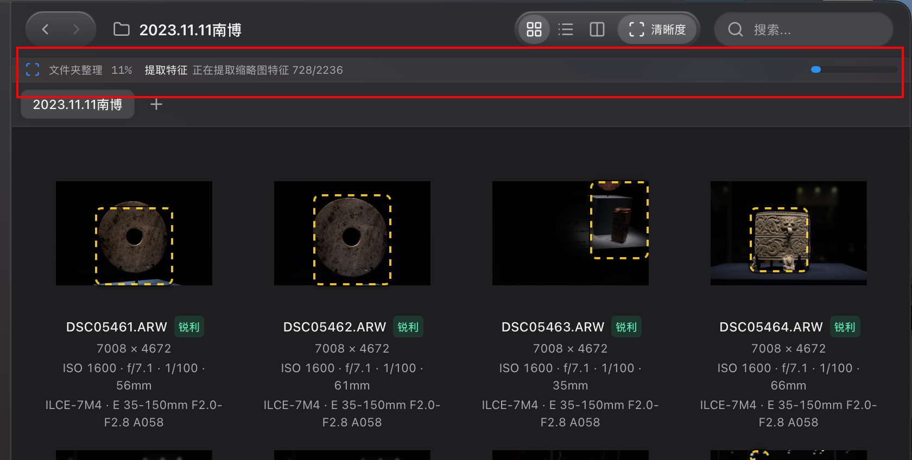
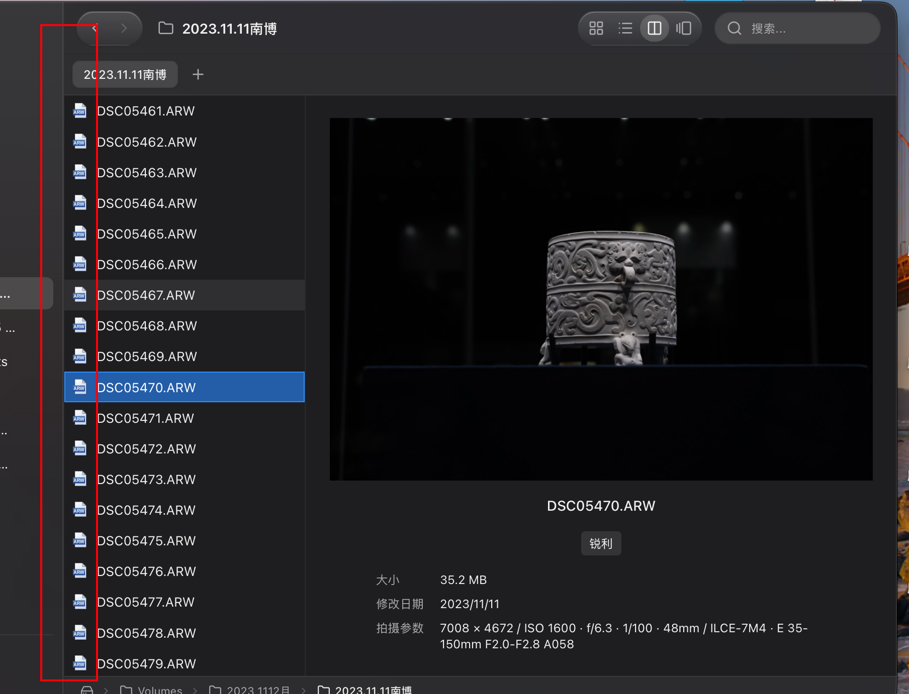
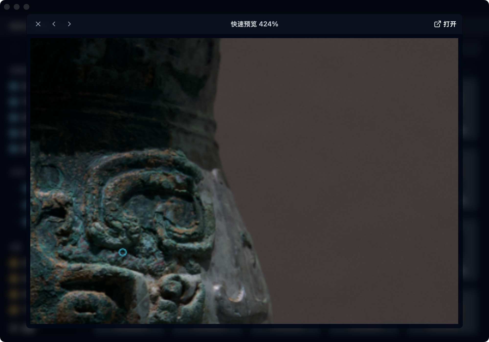

<div align="center">
  
  <h1>ImageExplorer</h1>
  <p>A macOS file browser for everyday file management and practical RAW photo review.</p>
  <p>English · <a href="./README.zh-CN.md">中文</a> · <a href="https://github.com/AITuring/ImageExplorer/releases">Download</a> · <a href="https://github.com/AITuring/ImageExplorer/actions/workflows/release.yml">Builds</a></p>
</div>


## Browse files. Review photos. Keep working.

ImageExplorer combines a Finder-inspired interface with an editable address bar, a folder tree and local indexed search. Browse files directly on disk without importing a photo library, then copy, move, rename, archive or open the originals in your preferred editor.



*Real-file example with analysis progress annotated in red. Screenshots show an earlier UI: the current app has three views, automatic analysis and no separate sharpness toggle. Older toolbar and metadata layouts pictured here are not the current layout.*

## Three views

| View | Best for | What you see |
| --- | --- | --- |
| **Icons · ⌘1** | Comparing compositions, bursts and similar viewpoints | Thumbnails, names, sharpness, dimensions and exposure settings; analysis can show viewpoint groups and focus markers |
| **List · ⌘2** | Finding, sorting and comparing files | Thumbnail, name, sharpness, ISO / aperture / shutter / focal length, size and modified date; no focus overlay on thumbnails |
| **Columns · ⌘3** | Navigating folders with a large single-file preview | File thumbnails on the left, image and detailed information on the right; defaults to the first item when nothing is selected |

Views share selection and sharpness styling; switching views locates the selected file. Folder analysis and its progress continue across views. Icons and lists use virtualized rendering; column thumbnails load when visible, with cached previews and bounded background work.



*Earlier column-view example. The red annotation marks the file-icon area, now replaced with the shared row thumbnails. The metadata panel is now divided into the groups below.*

## Photo information and sharpness

### A structured inspector

Available metadata is grouped rather than squeezed into a single line. Missing fields are omitted.

| Group | Fields |
| --- | --- |
| **Shooting settings** | ISO, aperture, shutter speed, focal length, capture time |
| **Camera & lens** | Manufacturer, camera model, lens name |
| **File information** | Pixel dimensions, megapixels, size, modification date, format |
| **Photo location** | Embedded GPS latitude/longitude, with an on-demand OpenStreetMap preview |

Metadata is read through macOS ImageIO with Spotlight fallback for some fields. RAW compatibility and field availability depend on macOS and the source file. GPS is never inferred: clicking **Show map** shares the recorded coordinates with OpenStreetMap; no map request is sent before that click.

### Automatic analysis for culling

- Folder analysis extracts visual features and groups similar viewpoints; progress reports the current stage and item count.
- Shared badges distinguish sharp, soft, pending and unavailable results across views.
- Sharpness is a preview-based aid, not proof of camera focus or a substitute for inspecting the original RAW at full size.
- Where available, Sony MakerNote coordinates provide camera AF regions. Center-only metadata is identified as an approximate display box; estimated focus and actual camera AF remain distinct.
- Sony AF metadata optionally uses ExifTool: `brew install exiftool`, or set `IMAGEEXPLORER_EXIFTOOL` / `EXIFTOOL_PATH`. Basic browsing does not require it.

### Space-bar Quick Look

Press **Space** on a file to preview it. Move between images, zoom around the pointer, inspect full-image or selected-area sharpness, and take advantage of adjacent RAW prefetching. Native preview support covers additional formats; open originals in the default app or another editor to continue editing.



*An earlier Quick Look capture showing detail inspection; focus markers and controls have evolved since this screenshot.*

## File management

| Feature | Capabilities |
| --- | --- |
| Navigation | Editable paths, breadcrumbs, back/forward history, collapsible folder tree and resizable sidebar |
| Local search | SQLite FTS5 index; select, rename and act on results. Initial indexing takes time |
| Mounted volumes | External disks and mounted-volume changes, with macOS access authorization where required |
| Tabs & windows | Multiple tabs/windows, tab detachment, navigation history and cross-window file movement |
| Copy & move | ⌘C / ⌘X / ⌘V, queued operations, progress, cancellation, errors and conflict resolution |
| Recovery | Keep both, replace, skip or cancel; persistent operation history, retries and one-step undo for recoverable operations |
| Organization | Inline and batch rename, sorting, arranging, new files and folders |
| Trash & ZIP | Browse/restore/empty Trash; queued ZIP compression and extraction |
| Get Info | Paths, permissions, ownership, timestamps, packages, aliases and symbolic links |
| Preferences | Favorites, recent locations, hidden files, light/dark/system theme, English and Simplified Chinese |

## Download and install

Visit [Releases](https://github.com/AITuring/ImageExplorer/releases) and choose a successful build:

- **Apple Silicon (M-series):** `ImageExplorer-macos-arm64.dmg`
- **Intel Mac:** `ImageExplorer-macos-x64.dmg`
- Open the DMG and drag the app to Applications. ZIP alternatives and `SHA256SUMS.txt` are also provided.

Push builds are **versioned GitHub Releases** (Latest, not prereleases), ad-hoc signed but not Apple Developer ID signed or notarized. macOS may block first launch. These builds do not publish automatic updater metadata. A production signed release requires separate signing credentials, an updater public key and release acceptance checks.

## Run locally

Install Node.js 24, pnpm 10, Rust stable and Xcode Command Line Tools (`xcode-select --install`).

```bash
git clone https://github.com/AITuring/ImageExplorer.git
cd ImageExplorer
pnpm install --frozen-lockfile
pnpm tauri dev
```

`pnpm tauri dev` runs the full desktop app with frontend hot reload. `pnpm dev` only serves the web frontend, without native filesystem/RAW capabilities. If port 1420 is occupied, stop the previous development server and retry.

```bash
# Build installers without an updater signing key
pnpm tauri build --bundles app,dmg --config '{"bundle":{"createUpdaterArtifacts":false}}'

# Frontend checks, formatting, Rust tests and Clippy
pnpm check:ci
```

Installers are written to `src-tauri/target/release/bundle/`.

## A release for every push

The [Release workflow](./.github/workflows/release.yml) runs on pushes to all branches and tags, and supports manual dispatch:

1. Install locked dependencies and run `pnpm check:ci` on Apple Silicon and Intel macOS runners.
2. Build `.dmg` and `.app.zip` packages for both architectures.
3. Atomically reserve a version before building, starting at `v0.1.0` and incrementing the patch: `v0.1.1`, `v0.1.2`, and so on. The app version matches its Release. After both builds succeed, publish checksums and a regular Release with the source ref and full commit SHA.
4. Each push runs independently without cancelling earlier builds. A rerun reuses its version. Concurrent pushes reserve distinct versions; Latest points to the highest published version. Failed builds retain reserved tags, so version gaps are possible. Failed checks/builds do not publish a visible release with missing installers.

Publishing uses the automatic `GITHUB_TOKEN` with `contents: write` only in the version-reservation and publish jobs; no personal token is required. Repository policy must allow Actions and release writes. Branch deletion does not publish; GitHub's bulk-push event limits still apply.

The separate [Signed Release workflow](./.github/workflows/release-signed.yml) accepts an existing version tag through manual dispatch, checks signing prerequisites and creates a reviewable draft. See the [release checklist](./docs/performance-release-checklist.md) for required credentials and acceptance criteria.

## Technology and documentation

React 19 · TypeScript · Tailwind CSS 4 · Tauri 2 · Rust · SQLite FTS5 · Vite

- [Finder gap analysis and development plan (Chinese)](./docs/finder-gap-analysis-and-development-plan.zh-CN.md)
- [Performance and production release checklist](./docs/performance-release-checklist.md)
- [Permissions and local data boundaries](./docs/permissions.md)

macOS is the current focus. Automated packages cover Apple Silicon and Intel; Windows/Linux production acceptance is not claimed.

## License

[BSL 1.1](./LICENSE). See the license file for the precise terms.
