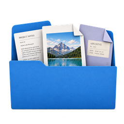
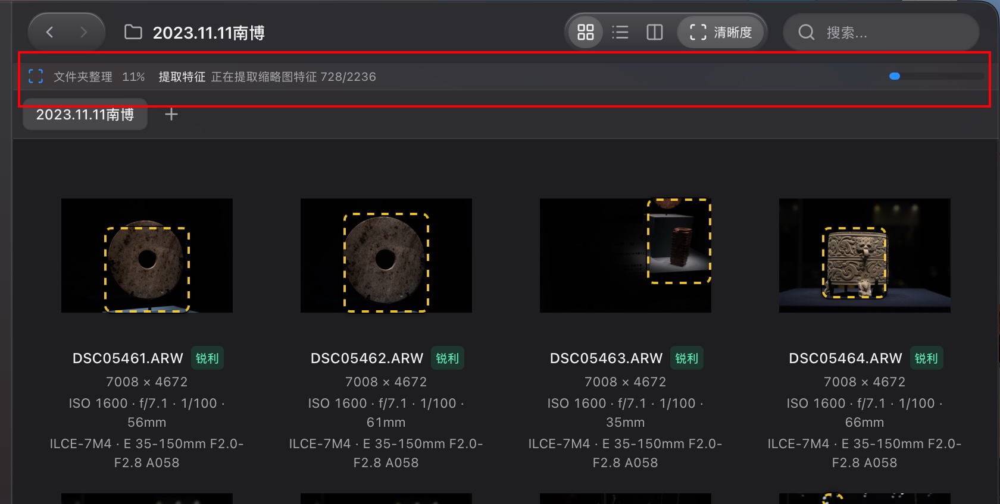
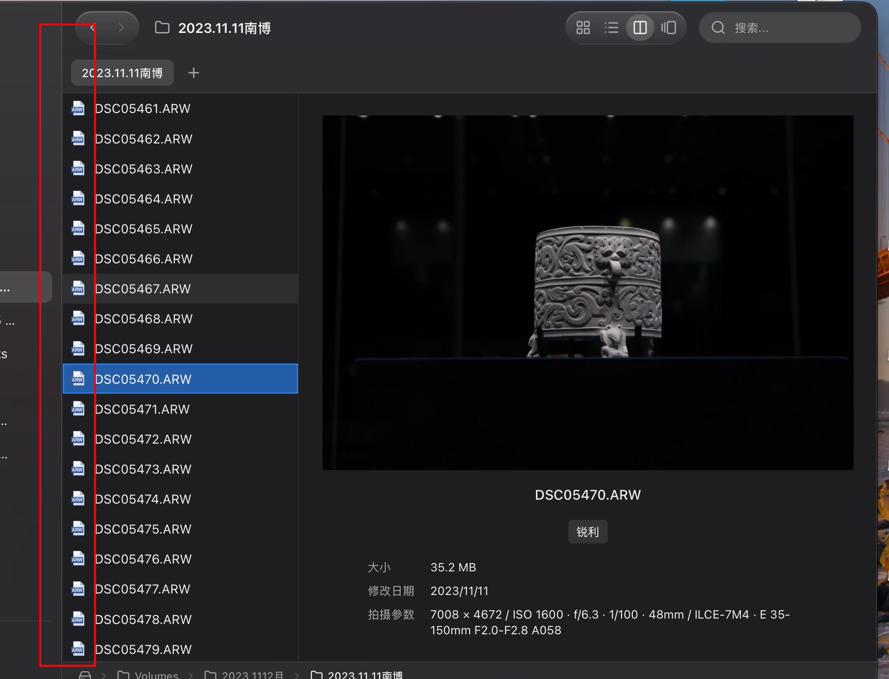
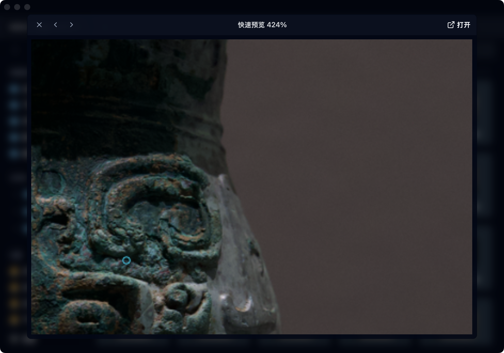

<div align="center">
  
  <h1>ImageExplorer</h1>
  <p><strong>A native-speed macOS Finder replacement &amp; local-first photography culling workbench.</strong></p>
  <p>Browse files directly on disk, cull RAW bursts at full speed, and run local Vision AI &amp; lossless EXIF workflows — all in one window, with zero cloud uploads.</p>
  <p>English · <a href="./README.zh-CN.md">中文</a> · <a href="https://github.com/AITuring/ImageExplorer/releases">Download</a> · <a href="https://github.com/AITuring/ImageExplorer/actions/workflows/release.yml">Builds</a></p>
</div>

<p align="center">
  
  
</p>

---

## Why ImageExplorer

Most photographers juggle **Finder** for disk organization, **Photo Mechanic / Lightroom** for RAW culling, and ad-hoc scripts for renaming, portrait sorting, or repairing EXIF stripped by Photoshop.

**ImageExplorer** brings them together into a single lightweight macOS desktop app built with **Tauri 2, Rust, Objective-C (ImageIO / Vision / AppKit), and React 19**:

- **Zero import, direct disk workflow** — Browse local drives and external SSDs/SD cards immediately without building a proprietary photo catalog.
- **100% local & privacy-first** — Face clustering, museum plaque OCR, sharpness analysis, and EXIF/GPS writing all run on-device using native macOS frameworks.
- **Non-destructive & reversible** — Lossless metadata merges, Adobe XMP sidecar sync, APFS clone copies, and one-click batch Undo keep originals safe.



*Example RAW browsing workflow. Screenshots reflect an earlier layout; the app now includes four views, dual-pane split mode, culling badges, and right-click AI/EXIF workbenches.*

---

## Feature Highlights

### 1. Finder-Grade File Management & Four Views

| View | Shortcut | Built for |
| --- | --- | --- |
| **Icons** | `⌘1` | Visual scanning, burst comparison, resizable thumbnails with culling/sharpness badges |
| **List** | `⌘2` | Fast sorting, inline expandable subfolders (`→` / `←`), resizable EXIF & file columns |
| **Columns** | `⌘3` | Miller-column navigation with resizable panes and a grouped EXIF / GPS inspector |
| **Gallery** | `⌘4` | Large hero preview above a virtualized filmstrip for rapid sequential review |

- **Dual-Pane Split View (`⌘\`)** — Side-by-side folder browsing with independent navigation and direct drag-and-drop between panes.
- **Group By Views** — Group any folder by **Kind**, **Date**, **Size**, or **Finder Tag** with collapsible headers.
- **Native macOS Integration** — APFS zero-copy clone copy, **macOS Finder Tags** & Tag Smart Folders, **AirDrop Share** (`NSSharingServicePicker`), lossless 90° rotate, Multi-Item Info Inspector (`⌘I` / `⌥⌘I`) with file lock toggle, Go-to-Folder (`⇧⌘G`) autocomplete, marquee auto-scroll, type-ahead jump, and external volume eject.
- **Storage & Reliability** — Multi-threaded **Storage Space Analyzer**, 3-stage **Duplicate File Finder** (size → head/tail sample → full SHA-256), queued copy/move/ZIP with conflict resolution, persistent operation history, retry & one-step Undo, Trash restore, and **SQLite FTS5** instant local search.



---

### 2. High-Speed RAW Photography Culling & Pro Quick Look

- **Multi-Brand Zero-Copy RAW Engine** — Extracts embedded JPEG previews directly from `.ARW`, `.CR2`, `.CR3`, `.NEF`, `.NRW`, `.RAF`, `.ORF`, `.RW2`, `.PEF`, `.DNG` and more via a custom binary `thumb://` protocol, backed by a persistent disk LRU thumbnail cache, SQLite EXIF cache, and adjacent-frame preloading.
- **Complete Culling Loop** — Flag Pick (`P`), Reject (`X`), Unflag (`U`), rate `⇧0`–`⇧5` stars directly in Grid/List/Gallery or Quick Look, toggle **Auto-Advance**, sort by **EXIF Capture Time**, and enable **RAW+JPG Stacking** so paired originals move, copy, delete, and rate together.
- **Multi-Dimensional Filter Bar** — Filter any folder live by keyword, format, sharpness, Pick/Reject/Unflagged state, minimum star rating, Finder tag, and camera/lens EXIF.
- **Automatic Burst & Sharpness Analysis** — Background worker groups similar viewpoints/bursts, highlights sharp vs. soft frames, supports **Auto-Pick Best**, and displays Sony MakerNote AF boxes when ExifTool is installed (`brew install exiftool`, optional).
- **Bi-Directional Adobe XMP Sidecars** — Imports existing `.xmp` ratings/flags and exports culling decisions back to `.xmp` without clobbering Lightroom or Adobe Camera Raw develop edits.
- **Pro Quick Look (`Space`) & Comparison**:
  - `Z` toggles **1:1 pixel zoom**; **`F` triggers macOS Vision Face/Eye 100% Focus Zoom** (cycling across detected faces/eyes for instant critical-focus checks).
  - Live **RGB Histogram** with toggleable **red/blue highlight & shadow clipping overlay**.
  - **2-Up PK Challenger & 3–4 Up Survey Compare** with synchronized pan/zoom and instant keep/reject controls.
  - Built-in **pure-Rust ZIP archive preview** alongside image, video, audio, PDF, and text previews.



---

### 3. Local Vision AI & One-Click Smart Photo Workbenches

Right-click any folder, empty directory area, or selected set of photos to launch specialized local workbenches:

#### Museum Exhibit Label Recognition (`Exhibit Label Recognition...`)
- Uses native **macOS Vision OCR** (`VNRecognizeTextRequest`, Chinese + English) to identify museum/gallery exhibit plaques interleaved with artifact photos.
- Automatically parses structured fields (`Era - Name - Provenance - Collection - OriginalFilename`), merges wrapped two-line titles, and flags multi-artifact shared plaques for per-photo assignment.
- Provides a side-by-side **Artifact & Plaque Visual Verifier**, live editable metadata fields, `.xmp` / `.acr` companion file syncing, and **one-click batch Undo**.

#### One-Click People Classification (`Group by People...`)
- Runs local **macOS Vision** face detection (`VNDetectFaceRectanglesRequest`) and L2-normalized feature embeddings (`VNGenerateImageFeaturePrintRequest`) across folders (including RAW files).
- Clusters photos of the same person with same-photo cannot-link constraints, offers an **instant strictness slider** (reclusters in milliseconds without rescanning), lets you rename or merge people, and handles multi-person shots flexibly (**Group Shots folder**, **Primary Face**, or **Copy to Each Person**).
- Organizes by Move or Copy with automatic `.xmp` / `.acr` companion sync and **one-click Undo**.

#### Lossless EXIF & GPS Repair / Sync Workbench (`Repair / Sync EXIF & GPS...`)
- Audits an entire folder or selection for missing **Capture Time**, **Camera/Lens**, **Exposure (ISO / Aperture / Shutter / Focal Length)**, and **GPS** — specifically solving Photoshop exports that strip EXIF metadata.
- **Three Sync Modes**:
  1. **Sync From Photo** — Pick any EXIF-bearing photo in the current folder or browse any file on disk (including `.ARW` / RAW originals as read-only references), then tweak or add GPS before batch writing.
  2. **Smart Stem Match** — Automatically pairs edited outputs (e.g. `DSC01684_1.jpg`) with their same-stem originals (`DSC01684.jpg` or `DSC01684.ARW`) in the folder.
  3. **Global Manual + Presets** — Set uniform time (with optional `+1s` batch increment to preserve order), camera/lens, exposure, and GPS (paste `"lat, lon"` directly from Apple/Google/Amap), and save reusable **Gear & Location Presets**.
- **Lossless & Safe**: Writes via macOS ImageIO `CGImageDestinationCopyImageSource` with exact EXIF rational encoding and atomic file replacement (**zero JPEG pixel re-compression**). Defaults to **Fill Missing Fields Only**, optionally syncs file `mtime`, and protects RAW files as read-only.

---

### 4. Ingest, Batch Rename & Native Export

- **SD Card Date Ingest** — Automatically organizes camera card imports into `YYYY/YYYY-MM-DD/` folders while skipping existing duplicates.
- **EXIF / Regex / Case Batch Rename** — Live-preview batch renamer supporting EXIF capture dates, camera model tokens, sequential numbering, regular expressions, and case transforms.
- **Multi-Threaded Native Batch Exporter** — Converts selected photos to **JPEG**, **HEIC**, or **PNG** with configurable max-edge resizing, quality control, and optional **GPS privacy stripping**.

---

## Keyboard Shortcuts

| Context | Shortcut | Action |
| --- | --- | --- |
| Views & Layout | `⌘1` / `⌘2` / `⌘3` / `⌘4` | Switch Icons / List / Columns / Gallery view |
| Views & Layout | `⌘\` | Toggle Dual-Pane Split View |
| Navigation | `⇧⌘G` / `⌘[` / `⌘]` | Go to Folder / Back / Forward |
| List View | `→` / `←` | Expand / collapse inline subfolder |
| Culling | `P` / `X` / `U` | Mark Pick / Reject / Unflagged |
| Culling | `⇧0` – `⇧5` | Set 0–5 star rating |
| Quick Look | `Space` | Open / close Quick Look preview |
| Quick Look | `Z` / `F` | Toggle 1:1 pixel zoom / Vision Face & Eye 100% focus zoom |
| Inspector | `⌘I` / `⌥⌘I` | Get Info / Multi-Item Inspector |
| File Ops | `⌘C` / `⌘X` / `⌘V` / `⌘D` | Copy / Cut / Paste / Duplicate |

---

## Download & Install

Visit [GitHub Releases](https://github.com/AITuring/ImageExplorer/releases) and download the latest build for your Mac:

- **Apple Silicon (M-series):** `ImageExplorer-macos-arm64.dmg`
- **Intel Mac:** `ImageExplorer-macos-x64.dmg`
- Open the DMG and drag **ImageExplorer** to Applications. `.app.zip` archives and `SHA256SUMS.txt` are also provided.

> **Note:** Push builds are published as versioned GitHub Releases using ad-hoc signing (not Apple Developer ID notarized), so macOS Gatekeeper may ask for confirmation on first launch.

---

## Local Development

Requirements: **Node.js 24**, **pnpm 10**, **Rust stable**, and **Xcode Command Line Tools** (`xcode-select --install`).

```bash
git clone https://github.com/AITuring/ImageExplorer.git
cd ImageExplorer
pnpm install --frozen-lockfile
pnpm tauri dev
```

`pnpm tauri dev` launches the full macOS desktop app with hot reload. `pnpm dev` runs only the frontend without native filesystem/ImageIO/Vision bindings.

```bash
# Run full CI checks: ESLint, TypeScript, frontend tests, Vite build, rustfmt, Rust tests & Clippy
pnpm check:ci

# Build local macOS .app and .dmg bundle without updater signing keys
APPLE_SIGNING_IDENTITY="-" pnpm tauri build --bundles app,dmg --config '{"bundle":{"createUpdaterArtifacts":false}}'
```

Built bundles are written to `src-tauri/target/release/bundle/`.

---

## Architecture & Tech Stack

- **Frontend:** React 19 · TypeScript · Tailwind CSS 4 · Zustand · `@tanstack/react-virtual` · Vite
- **Desktop Core:** Tauri 2 · Rust (`rayon`, `rusqlite` FTS5, `sha2`, custom `thumb://` protocol)
- **macOS Native Bridges (`src-tauri/native/quicklook_thumbnail.m`):** Objective-C bindings for `ImageIO` (RAW/JPEG decode, metadata read, lossless `CGImageDestinationCopyImageSource` EXIF/GPS write, native rotate), `Vision.framework` (text OCR, face/eye detection, face feature prints), `QuickLookThumbnailing`, and `AppKit` (`NSSharingServicePicker`, Finder tags, Spotlight).

## Automated Releases & Documentation

Every push runs the [CI](./.github/workflows/ci.yml) and [Release](./.github/workflows/release.yml) workflows on both Apple Silicon (`macos-14`) and Intel (`macos-15-intel`) runners, executing `pnpm check:ci`, reserving the next patch version atomically, and publishing signed checksums + `.dmg`/`.app.zip` artifacts upon full success.

- [Finder Gap Analysis & Development Plan (Chinese)](./docs/finder-gap-analysis-and-development-plan.zh-CN.md)
- [Performance & Production Release Checklist](./docs/performance-release-checklist.md)
- [Permissions & Local Data Boundaries](./docs/permissions.md)

## License

[BSL 1.1](./LICENSE). See the license file for exact terms.
