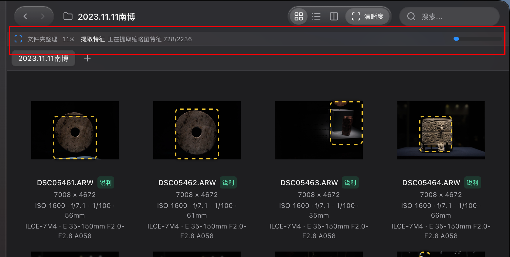
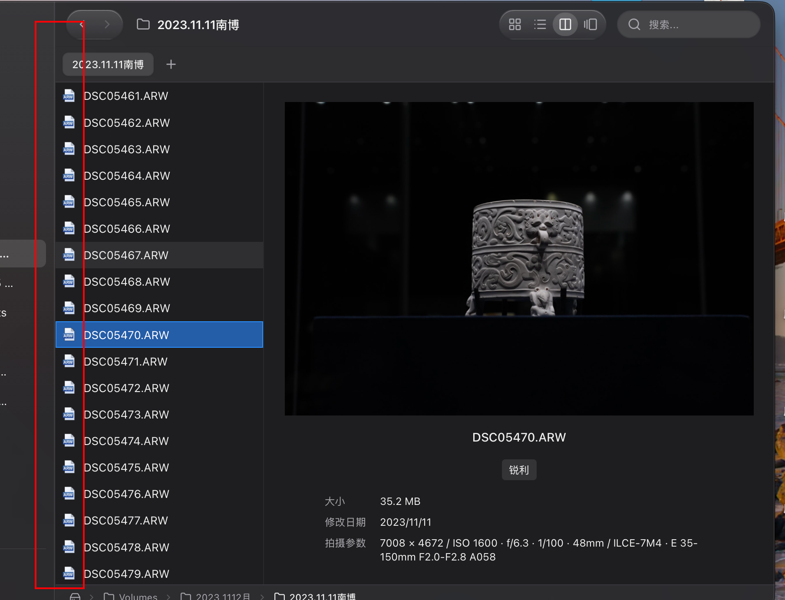

<div align="center">
  
  <h1>ImageExplorer</h1>
  <p>面向 macOS 的文件浏览器，让日常文件管理与 RAW 照片筛选在同一个窗口完成。</p>
  <p><a href="./README.md">English</a> · 中文 · <a href="https://github.com/AITuring/ImageExplorer/releases">下载安装</a> · <a href="https://github.com/AITuring/ImageExplorer/actions/workflows/release.yml">自动构建</a></p>
</div>


## 看得见照片，也管得好文件

ImageExplorer 结合 Finder 风格的界面、可编辑路径栏、目录树和本地索引搜索。它直接浏览磁盘上的文件，不需要先把照片导入图库；选片之后可以继续复制、移动、重命名、压缩或交给外部编辑器处理。



*实拍文件浏览示例，红框标示整理进度。文中截图来自此前界面版本：当前仅保留图标、列表、分栏三种视图，清晰度自动分析，已移除独立开关。截图中的旧工具栏和参数排版不代表当前布局。*

## 三种视图，各有用途

| 视图 | 适合做什么 | 显示内容 |
| --- | --- | --- |
| **图标 · ⌘1** | 对比构图、连续拍摄和相似视角 | 缩略图、文件名、清晰度标签、像素尺寸与拍摄参数；照片分析可显示视角分组及焦点标记 |
| **列表 · ⌘2** | 快速查找文件、对比参数和排序 | 缩略图、名称、清晰度、ISO / 光圈 / 快门 / 焦距、大小、修改日期；缩略图不叠加焦点框 |
| **分栏 · ⌘3** | 逐层浏览文件夹，同时查看单张照片 | 左侧文件缩略图，右侧大图、清晰度、详细参数；无选择时默认选中第一项 |

三个视图共用文件选择状态与清晰度样式；切换视图按选中文件定位。整理任务和进度不依赖当前视图。大量图片采用缓存、有界后台任务，列表与图标采用虚拟化渲染，分栏缩略图仅在可见时请求。



*分栏预览示例，红框标示文件图标区域；当前该区域已改为与列表共用的缩略图，右侧参数也已拆分为下面的分组。*

## 照片信息与清晰度

### 详细参数，不再挤成一行

分栏右侧将可读取的信息分组显示，缺失字段不占位：

| 分组 | 字段 |
| --- | --- |
| **拍摄参数** | 感光度 ISO、光圈、快门速度、焦距、拍摄时间 |
| **相机与镜头** | 制造商、相机型号、镜头名称 |
| **文件信息** | 宽高像素、百万像素数、文件大小、修改时间、格式 |
| **拍摄位置** | 文件内嵌的 GPS 经纬度；点击“显示地图”加载 OpenStreetMap |

照片参数优先通过 macOS ImageIO 读取，部分字段使用 Spotlight 回退。RAW 支持和字段完整性取决于 macOS 解码能力及文件本身。GPS 不会凭空推断；加载地图会将该坐标发送给 OpenStreetMap，未点击时不请求地图。

### 自动分析，辅助选片

- 文件夹照片自动提取特征、识别相似视角，进度条显示当前阶段和处理数量。
- 清晰度标签区分“锐利”、偏软、检测中或不可用，三种视图使用一致的样式。
- 清晰度是基于预览图的辅助判断，不能替代原始 RAW 的全尺寸检查，也不是相机实际合焦状态。
- 有可用 Sony MakerNote 坐标时，可显示相机 AF 区域；只有中心点时标记为近似显示框。缺少相机坐标时，估计焦点与相机 AF 分开标识。
- Sony AF 元数据可选依赖 ExifTool：`brew install exiftool`，也可通过 `IMAGEEXPLORER_EXIFTOOL` 或 `EXIFTOOL_PATH` 指定可执行文件。普通浏览不要求安装它。

### 空格快速预览

选中文件按 **Space** 打开 Quick Look。支持前后切图、以鼠标位置为中心缩放、全图或选区清晰度分析，以及相邻 RAW 预取。原生预览能力用于兼容更多格式；照片可交给系统默认应用或其他编辑器继续处理。


*早期 Quick Look 实拍截图，演示放大检查细节；焦点标记与控制布局已随版本更新。*

## 文件管理功能

| 功能 | 能做什么 |
| --- | --- |
| 路径与导航 | 输入完整路径、点击面包屑、前进/后退；可折叠目录树、可调宽侧边栏 |
| 本地搜索 | SQLite FTS5 索引搜索；结果支持选择、右键操作和重命名，首次索引需要时间 |
| 外置卷 | 在侧边栏显示已挂载卷，响应挂载变化；访问受保护目录时遵循 macOS 授权 |
| 标签页与窗口 | 多标签、多窗口、拖动分离标签页、保留导航历史、跨窗口移动文件 |
| 复制与移动 | ⌘C / ⌘X / ⌘V，任务队列、进度、取消、错误提示与同名冲突处理 |
| 冲突与恢复 | 保留两者、替换、跳过或取消；持久化操作记录，失败任务重试，支持可恢复操作的一步撤销 |
| 重命名与整理 | 行内重命名、批量重命名、排序、整理、新建文件与文件夹 |
| 废纸篓与 ZIP | 浏览/恢复/清空废纸篓，压缩与解压 ZIP；耗时操作进入任务队列 |
| 文件简介 | 路径、权限、所有者、时间，以及包、别名、符号链接信息 |
| 常用位置 | 收藏夹、最近位置、隐藏文件显示；浅色/深色/跟随系统，中英双语 |

## 下载与安装

前往 [Releases](https://github.com/AITuring/ImageExplorer/releases)，选择最新的成功构建：

- **Apple Silicon（M 系列）**：`ImageExplorer-macos-arm64.dmg`
- **Intel Mac**：`ImageExplorer-macos-x64.dmg`
- 打开 DMG，将应用拖入 Applications；也提供 `.app.zip` 和 `SHA256SUMS.txt`。

每次 push 发布的是带版本号的 **正式 GitHub Release**（标记为 Latest，而非 Pre-release），使用临时签名，未经 Apple Developer ID 签名和公证，macOS 可能阻止首次启动。当前构建不提供自动更新元数据。正式签名/公证发布需要单独配置密钥和 updater 公钥，不能将自动构建成功等同于正式发行验收。

## 本地启动

需要 Node.js 24、pnpm 10、Rust stable，以及 Xcode Command Line Tools（`xcode-select --install`）。

```bash
git clone https://github.com/AITuring/ImageExplorer.git
cd ImageExplorer
pnpm install --frozen-lockfile
pnpm tauri dev
```

`pnpm tauri dev` 启动完整桌面应用并支持前端热更新；`pnpm dev` 只启动网页前端，不能独立提供文件系统和 RAW 原生能力。若提示端口 1420 被占用，请停止此前的开发服务后重试。

```bash
# 本地构建安装包，不需要 updater 签名密钥
pnpm tauri build --bundles app,dmg --config '{"bundle":{"createUpdaterArtifacts":false}}'

# 完整自动检查：前端、格式、Rust 测试与 Clippy
pnpm check:ci
```

安装包输出在 `src-tauri/target/release/bundle/`。

## 每次 push 自动发布

[Release 工作流](./.github/workflows/release.yml) 对所有分支和标签的 push 运行，也支持手动触发：

1. 在 Apple Silicon 与 Intel macOS runner 上安装锁定依赖，执行 `pnpm check:ci`。
2. 分别构建 `.dmg` 和 `.app.zip`，汇总两个架构的产物。
3. 构建前原子预留版本号，从 `v0.1.0` 开始递增补丁号：`v0.1.1`、`v0.1.2`……；安装包内版本与 Release 一致。两端都成功后生成 SHA-256 校验文件并发布正式 Release，记录来源引用与完整 commit SHA。
4. 每次 push 独立运行，不取消前一次构建；重跑同一任务复用同一个版本。并发推送不会占用相同版本，Latest 指向已发布的最高版本；失败构建保留已占用的标签，因此版本可能跳号。检查或构建失败时不发布缺少安装包的正式可见 Release。

发布仅使用 GitHub 自动提供的 `GITHUB_TOKEN`（版本预留和发布 job 的 `contents: write`），不需要另建 PAT。仓库需允许 GitHub Actions 运行和写入 Release。删除分支不发布；GitHub 对大批量标签/分支推送的事件限制仍适用。

[Signed Release](./.github/workflows/release-signed.yml) 保留为手动入口，输入已有版本标签，严格检查签名配置并生成待审阅草稿。具体密钥与正式发布验收见 [发布清单](./docs/performance-release-checklist.md)。

## 技术与项目文档

React 19 · TypeScript · Tailwind CSS 4 · Tauri 2 · Rust · SQLite FTS5 · Vite

- [Finder 差异分析与开发计划](./docs/finder-gap-analysis-and-development-plan.zh-CN.md)
- [性能与正式发布清单](./docs/performance-release-checklist.md)
- [权限与本地数据边界](./docs/permissions.md)

当前重点是 macOS，自动安装包覆盖 Apple Silicon 与 Intel；不宣称 Windows/Linux 已完成发行验收。

## 许可证

[BSL 1.1](./LICENSE)，具体使用授权以 LICENSE 为准。
