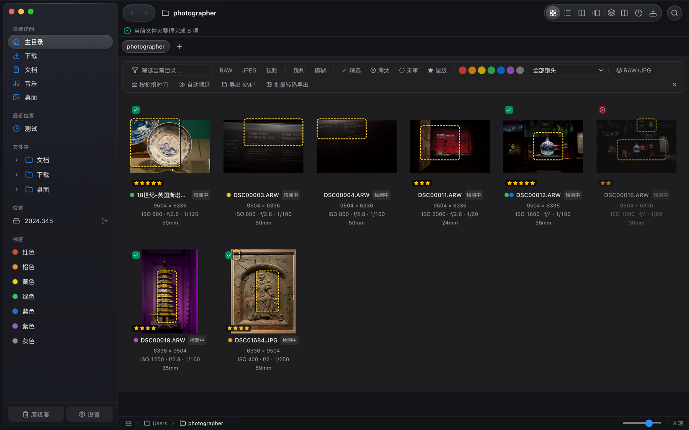
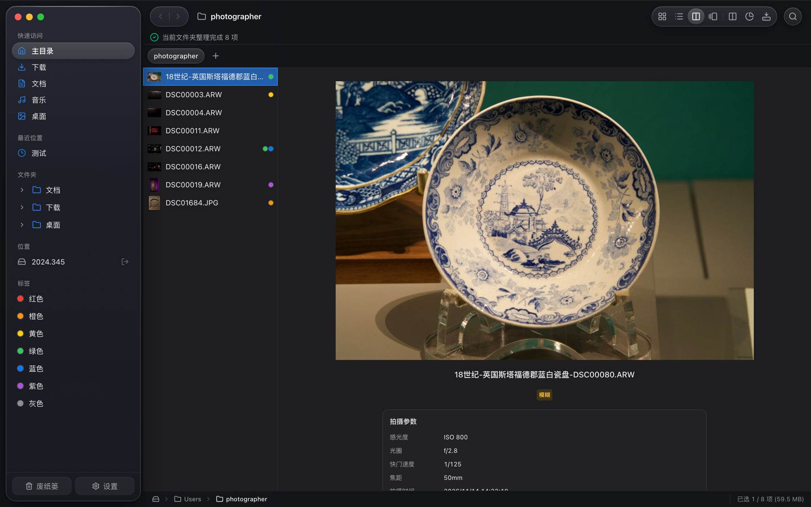
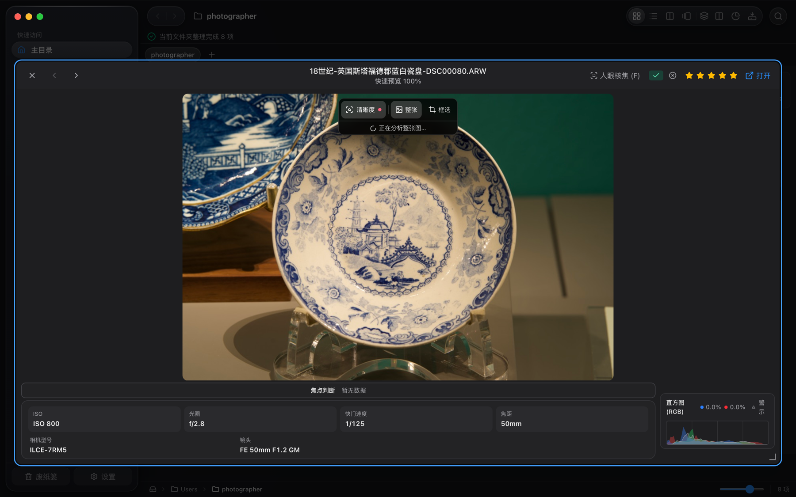
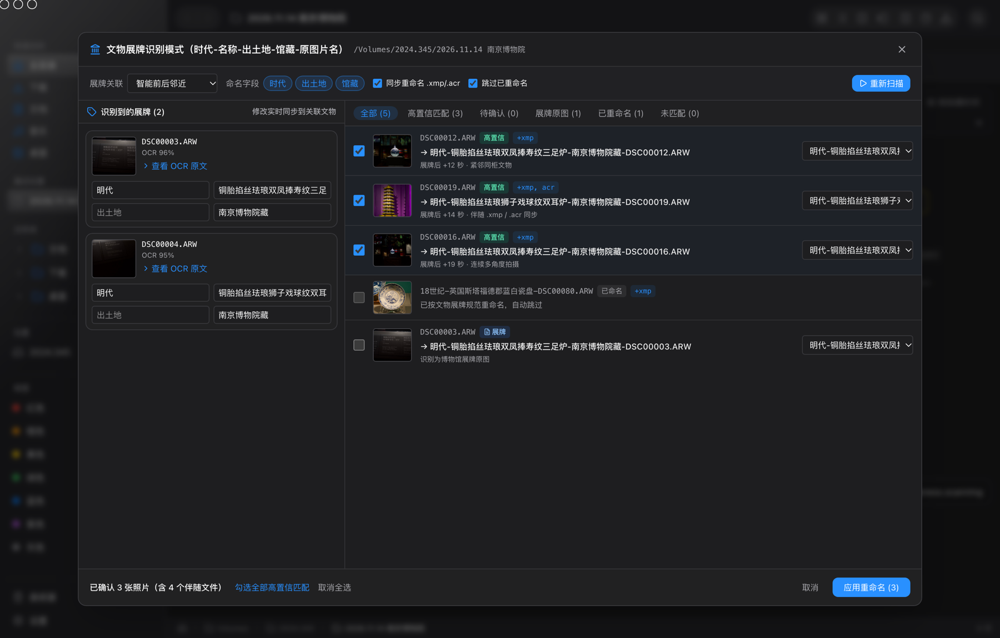
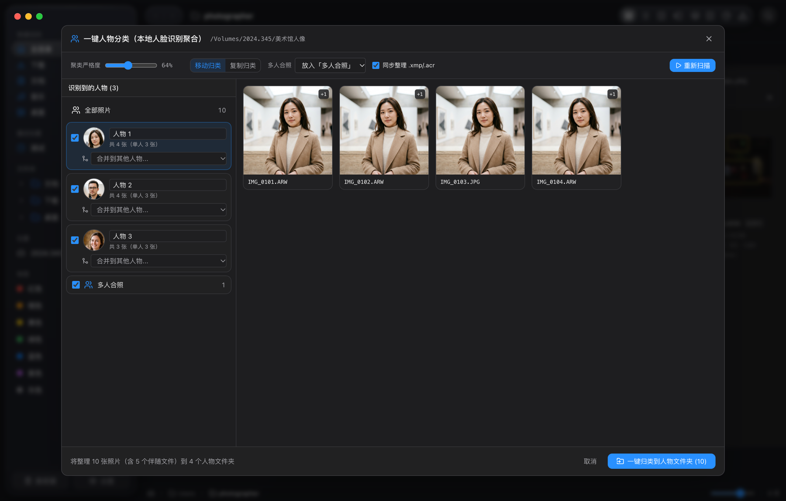
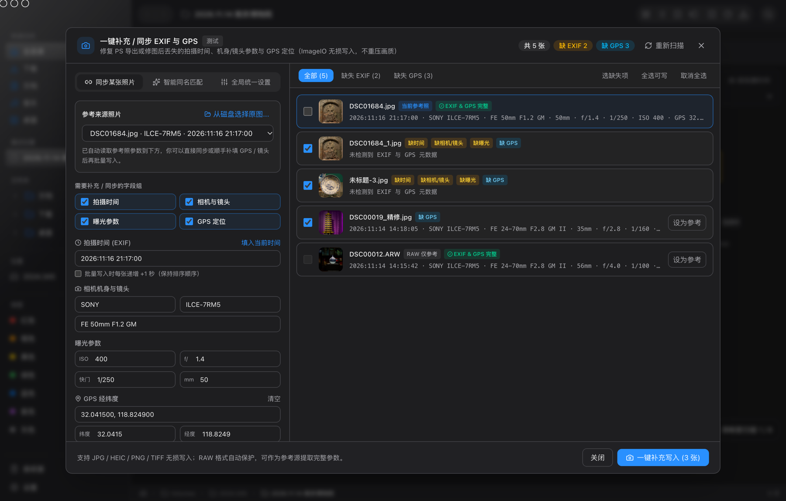

<div align="center">
  
  <h1>ImageExplorer</h1>
  <p><strong>面向 macOS 的原生级文件浏览器 × 高速摄影选片与本地 AI 影像工作台。</strong></p>
  <p>免导入直读硬盘与外置移动盘，在一个窗口里完成 Finder 级文件管理、RAW 极速选片、文物展牌识别命名、本地人物聚合分类与无损 EXIF/GPS 修复。</p>
  <p><a href="./README.md">English</a> · 中文 · <a href="https://github.com/AITuring/ImageExplorer/releases">下载安装</a> · <a href="https://github.com/AITuring/ImageExplorer/actions/workflows/release.yml">自动构建</a></p>
</div>

<p align="center">
  
  
</p>

---

## 为什么做 ImageExplorer

日常摄影与文件整理中，我们常常不得不在 **Finder（管理文件）**、**Photo Mechanic / Lightroom（高速看 RAW 选片）** 和各种 **零散脚本（改名、按人像分文件夹、补修 PS 丢失的 EXIF/GPS）** 之间反复切换。

**ImageExplorer** 基于 **Tauri 2 + Rust + Objective-C（ImageIO / Vision / AppKit）+ React 19** 打造，将它们融为一体：

- **免导入、直读磁盘**：无需建立封闭图库，插入 SD 卡或移动硬盘即可直接浏览、筛选、重命名和整理原片。
- **100% 本地离线、隐私安全**：人脸特征聚类、展牌中英文 OCR、清晰度分析与无损 EXIF/GPS 写入全部在 macOS 本机完成，绝不上传云端。
- **无损且可撤销**：ImageIO 无损元数据合并、Adobe XMP 双向同步、APFS 零拷贝克隆与批量一键撤销，确保原片始终安全。



*主界面图标选片视图：顶部四视图与分屏工具栏、文件夹内多维筛选栏、精选/淘汰/星级角标、Finder 颜色标签、焦点框与拍摄参数一目了然。*

---

## 核心功能全景

### 1. Finder 级文件管理与四种视图

| 视图 | 快捷键 | 适用场景 |
| --- | --- | --- |
| **图标视图** | `⌘1` | 快速浏览构图与连拍，支持缩略图滑块调节与选片/清晰度角标 |
| **列表视图** | `⌘2` | 高效排序与参数对比，支持 **行内展开子文件夹（`→` / `←`）** 与可调宽 EXIF/文件列 |
| **分栏视图** | `⌘3` | 多层级目录浏览，支持可调栏宽与分组化 EXIF / GPS 详情检查器 |
| **画廊视图** | `⌘4` | 上方高清大图 + 下方虚拟化胶片条，专注逐张精筛 |

- **双栏分屏（`⌘\`）**：左右双窗格独立导航，支持跨窗格直接拖拽复制/移动文件。
- **分组视图（Group By）**：按 **种类、修改日期、大小、Finder 标签** 分组折叠显示。
- **深度 macOS 原生能力**：APFS 克隆秒级复制、**macOS Finder 标签** 与标签智能文件夹、**AirDrop 共享**（`NSSharingServicePicker`）、无损 90° 左右旋转、**多选汇总简介（`⌘I` / `⌥⌘I`）** 与文件锁定开关、路径跳转（`⇧⌘G`）自动补全、框选自动滚动、首字母快跳、外置磁盘监听与一键推出。
- **空间治理与可靠传输**：多线程 **存储空间分析器**、三阶段 **重复文件查找器**（大小 → 首尾采样 → 全量 SHA-256）、带冲突处理与进度队列的复制/移动/ZIP 压缩解压、持久化操作记录与一键撤销、废纸篓浏览恢复，以及 **SQLite FTS5** 本地极速搜索。



---

### 2. 高速 RAW 摄影选片与专业 Quick Look

- **多品牌零拷贝 RAW 引擎**：直接解析 `.ARW` / `.CR2` / `.CR3` / `.NEF` / `.NRW` / `.RAF` / `.ORF` / `.RW2` / `.PEF` / `.DNG` 内嵌预览图，配合自定义二进制 `thumb://` 协议、磁盘 LRU 缩略图缓存、SQLite EXIF 缓存与相邻帧预取，翻图丝滑零卡顿。
- **完整选片闭环**：全局与预览窗均支持 **精选（`P`）/ 淘汰（`X`）/ 清除（`U`）**、**星级评定（`⇧0`–`⇧5`）**、**自动前进下一张（Auto-Advance）**、**按 EXIF 拍摄时间排序**，以及 **RAW+JPG 堆叠联动**（复制、移动、删除、标星自动成对处理）。
- **文件夹内多维筛选栏**：按关键词、文件格式、清晰度、精选/淘汰/未标记、最低星级、Finder 标签与相机/镜头 EXIF 实时组合过滤。
- **自动连拍分组与清晰度分析**：后台 Worker 自动聚类相似视角/连拍组、标注锐利度并支持 **连拍自动择优（Auto-Pick Best）**；安装 ExifTool（`brew install exiftool`，可选）后可叠加显示 Sony MakerNote 相机对焦框。
- **Adobe XMP 侧车文件双向同步**：既可导入已有 `.xmp` 星级与旗标，也可导出选片结果并无损合并进 `.xmp`，完整保留 Lightroom / Camera Raw 调色参数。
- **专业空格预览（`Space`）与多图对比**：
  - `Z` 一键切换 **1:1 像素原大**；**`F` 一键触发 macOS Vision 人脸/眼部 100% 对焦放大**（循环切换画面中每张人脸/眼睛，极速核对跑焦）。
  - 实时 **RGB 直方图** 与 **红/蓝高光欠曝溢出警告叠层**。
  - **双图 PK 擂台对比 & 3–4 图联排对比**，支持同步缩放平移与即时留用/淘汰。
  - 除图片、视频、音频、PDF、文本外，还内置 **纯 Rust ZIP 压缩包目录直览**。



---

### 3. 本地 Vision AI 与一键影像工作台

在任意文件夹空白处、目标文件夹或选中照片上 **右键**，即可唤起三大专业本地工作台：

#### 文物展牌识别模式（`文物展牌识别模式...`）
- 调用 macOS 原生 **Vision OCR**（`VNRecognizeTextRequest`，中英混合识别）自动识别博物馆/展览中与文物交替拍摄的展牌照片。
- 严格提取并生成 **`时代-名称-出土地-馆藏-原图片名`** 规范命名，支持双行折行标题自动拼接、多文物共享展牌检测与逐张手动指定。
- 内置 **文物与展牌并排核对视图**、元数据实时编辑联动、`.xmp` / `.acr` 伴随文件同步重命名与 **整批一键撤销**。



#### 一键人物分类（`一键人物分类...`）
- 调用 macOS 原生 **Vision** 人脸检测（`VNDetectFaceRectanglesRequest`）与 L2 归一化特征向量（`VNGenerateImageFeaturePrintRequest`），直接支持 RAW 与常见图片格式。
- 内置同照互斥约束聚类，提供 **聚类严格度实时滑块**（毫秒级重聚，无需重新扫描），支持重命名人物文件夹、手动合并拆分人物，并提供 **多人合照灵活策略**（归入「多人合照」/ 按主人物归类 / 复制到各自文件夹）。
- 支持移动或复制归类、同步整理 `.xmp` / `.acr` 伴随文件与 **一键撤销恢复原路径**。



#### 一键补充 / 同步 EXIF 与 GPS（`一键补充 / 同步 EXIF 与 GPS...`）
- 自动审计整个文件夹或选中照片缺失的 **拍摄时间、相机/镜头、曝光参数（ISO/光圈/快门/焦距）与 GPS 定位**，彻底解决 Photoshop 导出或修图后 EXIF 丢失的痛点。
- **三种同步模式自由切换**：
  1. **同步某张照片**：一键选取本目录含 EXIF 的原图，或跨目录从磁盘挑选任意原片/RAW 作为只读参考源，读取后还可顺手补填 GPS 再批量写入。
  2. **智能同名匹配**：自动将修图导出文件（如 `DSC01684_1.jpg`）与同目录同名原片或 RAW（如 `DSC01684.jpg` / `.ARW`）一对一配对回填原始参数。
  3. **全局统一设置 + 常用预设**：手动设定拍摄时间（支持批量 `+1 秒递增` 保持顺序）、机身/镜头、曝光与 GPS（支持直接粘贴苹果/高德/谷歌地图的 `纬度, 经度` 坐标对），并可保存复用 **常用器材与地点预设**。
- **无损安全写入**：基于 macOS ImageIO `CGImageDestinationCopyImageSource` 与精确 EXIF 有理分数编码原子替换写入，**绝不重新压缩 JPEG 像素画质**；默认 **仅补全缺失字段**（也支持强制覆盖），可选同步更新文件修改时间 `mtime`，并自动保护 RAW 只读不被改写。



---

### 4. SD 卡导片、批量重命名与原生导出

- **SD 卡按日期一键导入**：自动按 `YYYY/YYYY-MM-DD/` 目录结构拷贝归档，智能跳过已存在重复文件。
- **EXIF / 正则 / 大小写批量重命名**：支持拍摄日期、机身型号、序号模板、正则表达式替换与大小写转换，实时预览新文件名。
- **多线程原生批量转码导出**：支持导出 **JPEG / HEIC / PNG**，自定义长边尺寸、压缩质量以及可选 **抹除 GPS 隐私信息**。

---

## 常用快捷键一览

| 场景 | 快捷键 | 功能 |
| --- | --- | --- |
| 视图与布局 | `⌘1` / `⌘2` / `⌘3` / `⌘4` | 切换 图标 / 列表 / 分栏 / 画廊 视图 |
| 视图与布局 | `⌘\` | 开启 / 关闭双栏分屏 |
| 目录导航 | `⇧⌘G` / `⌘[` / `⌘]` | 前往文件夹 / 后退 / 前进 |
| 列表视图 | `→` / `←` | 行内展开 / 收起子文件夹 |
| 极速选片 | `P` / `X` / `U` | 标记精选 / 淘汰 / 清除标记 |
| 极速选片 | `⇧0` – `⇧5` | 设置 0–5 星评级 |
| 快速预览 | `Space` | 打开 / 关闭 Quick Look 预览 |
| 快速预览 | `Z` / `F` | 切换 1:1 像素原大 / Vision 人脸眼部 100% 对焦放大 |
| 文件信息 | `⌘I` / `⌥⌘I` | 显示简介 / 多选汇总简介 |
| 文件操作 | `⌘C` / `⌘X` / `⌘V` / `⌘D` | 复制 / 剪切 / 粘贴 / 制作副本 |

---

## 下载与安装

前往 [GitHub Releases](https://github.com/AITuring/ImageExplorer/releases) 下载对应架构的最新构建：

- **Apple Silicon（M 系列芯片）**：`ImageExplorer-macos-arm64.dmg`
- **Intel Mac**：`ImageExplorer-macos-x64.dmg`
- 打开 DMG，将 **ImageExplorer** 拖入 Applications；同时提供 `.app.zip` 与 `SHA256SUMS.txt`。

> **提示**：每次 push 自动发布的版本采用临时签名（未经 Apple Developer ID 公证），首次启动时如遇 macOS 安全提示，请在「系统设置 → 隐私与安全性」中允许打开。

---

## 本地开发与构建

环境要求：**Node.js 24**、**pnpm 10**、**Rust stable** 以及 **Xcode Command Line Tools**（`xcode-select --install`）。

```bash
git clone https://github.com/AITuring/ImageExplorer.git
cd ImageExplorer
pnpm install --frozen-lockfile
pnpm tauri dev
```

`pnpm tauri dev` 会启动完整的 macOS 桌面应用并支持前端热更新；`pnpm dev` 仅启动前端页面，不包含原生文件系统、ImageIO 与 Vision 能力。

```bash
# 运行完整 CI 检查：ESLint、TypeScript、前端测试、Vite 构建、rustfmt、Rust 测试与 Clippy
pnpm check:ci

# 本地打包 macOS .app 与 .dmg（无需 updater 签名密钥）
APPLE_SIGNING_IDENTITY="-" pnpm tauri build --bundles app,dmg --config '{"bundle":{"createUpdaterArtifacts":false}}'
```

构建产物输出在 `src-tauri/target/release/bundle/`。

---

## 技术架构

- **前端界面**：React 19 · TypeScript · Tailwind CSS 4 · Zustand · `@tanstack/react-virtual` · Vite
- **桌面内核**：Tauri 2 · Rust（`rayon` 并行、`rusqlite` FTS5 索引、`sha2`、自定义 `thumb://` 二进制协议）
- **macOS 原生桥接（`src-tauri/native/quicklook_thumbnail.m`）**：Objective-C 深度封装 `ImageIO`（RAW/JPEG 解码、元数据读取、`CGImageDestinationCopyImageSource` 无损 EXIF/GPS 写入、原生旋转）、`Vision.framework`（中英文文本 OCR、人脸/眼部检测、人脸特征提取）、`QuickLookThumbnailing` 与 `AppKit`（`NSSharingServicePicker`、Finder 标签、Spotlight）。

## 自动构建与项目文档

每次推送均会自动触发 [CI](./.github/workflows/ci.yml) 与 [Release](./.github/workflows/release.yml) 工作流，在 Apple Silicon（`macos-14`）与 Intel（`macos-15-intel`）双架构 macOS 环境下通过全部 `pnpm check:ci` 校验后，原子递增版本号并发布附带 SHA-256 校验文件的正式 Release。

- [Finder 差异分析与开发计划](./docs/finder-gap-analysis-and-development-plan.zh-CN.md)
- [性能与正式发布清单](./docs/performance-release-checklist.md)
- [权限与本地数据边界](./docs/permissions.md)

## 许可证

[BSL 1.1](./LICENSE)，具体授权条款以 LICENSE 文件为准。
