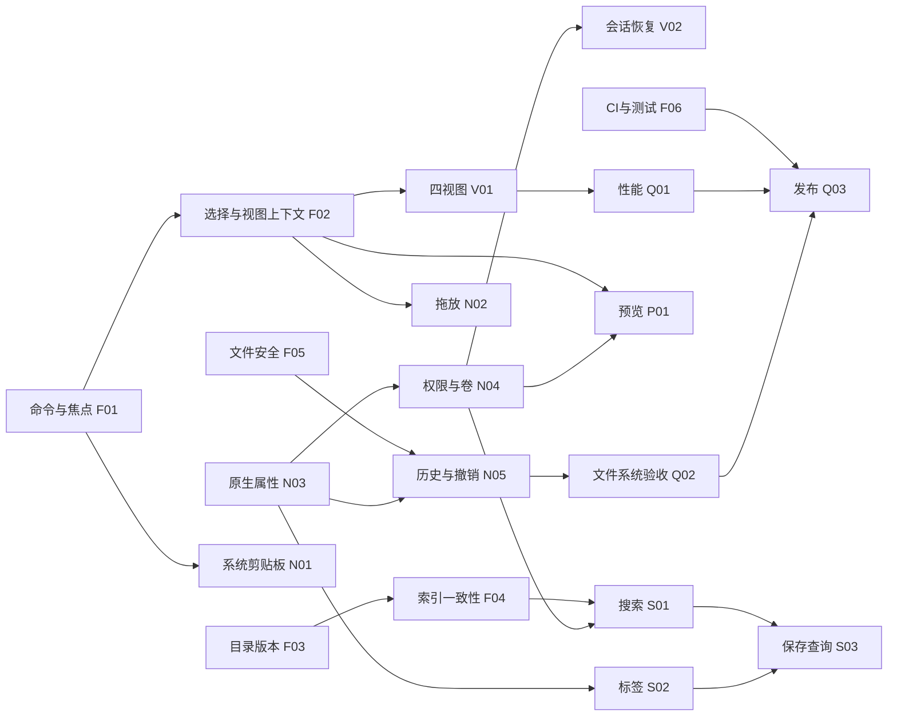

# ImageExplorer 与 macOS Finder 差异分析及开发计划

评估日期：2026-10-21。代码基线：`c6f211f`（`perf: 优化文件列表排序与照片分析性能`）。

本文用于后续需求拆分、技术设计、排期和验收。推荐产品方向是：**以 Finder 的文件操作可靠性和系统互通为基础，保留可编辑地址栏、常驻目录树和摄影筛选能力。** 首轮开发应优先修复操作对象、目录状态和数据安全问题，随后完善交互，再扩展搜索与摄影功能。

## 1. 评估范围与结论边界

本次核对了 React 前端、Rust 文件操作、SQLite 索引、目录监听、macOS 桥接、权限配置、测试脚本及发布工作流；Finder 基线参考 Apple 官方使用文档。没有启动应用进行完整交互测试，没有执行真实文件搬移、磁盘拔插、Photoshop 拖入或签名包安装。

状态含义：

| 标记 | 含义 |
| --- | --- |
| 已实现 | 当前源码存在相应功能路径，仍需指定场景验收 |
| 部分实现 | 有入口和部分行为，但关键语义、边界或系统集成尚不完整 |
| 未发现 | 本次检查的相关模块中未找到实现，需要开发或进一步确认 |
| 静态风险 | 能从代码推导出失败路径，尚未通过本次实机复现 |
| 已验证 | 仅用于本次实际执行且有结果的检查 |

本次执行 `pnpm check` 成功：TypeScript 无错误；ESLint 无错误、1 条警告，位置为 `FileGalleryView.tsx:107` 的 `react-hooks/incompatible-library`。该脚本包含 `eslint --fix`，执行后确认没有业务源码变更。未运行 Rust 测试、生产构建或性能基准；不能由前端检查推导文件操作可靠、预览准确或性能达标。

Apple 在线手册会随 macOS 更新，本文比较通用行为。正式验收要记录准确的 macOS 版本、架构和文件系统；`minimumSystemVersion: 10.15` 目前只是项目配置，不能当成已通过兼容性测试。

## 2. 项目定位和已有基础

### 2.1 应继续保留的能力

- 文件操作已有顺序队列、进度、取消、冲突处理、重试、持久化记录和部分撤销；应扩展现有实现。
- 跨卷移动已有复制、校验、再删除源文件的路径；macOS 元数据复制和符号链接复制也已有实现。
- 图标、列表等视图已有虚拟化，缩略图有并发限制与有界缓存。
- 多标签页、多窗口、跨窗口标签传递、目录树、收藏夹、最近访问目录已有实现。
- 批量重命名已有多选入口和独立对话框，后续重点是日志、部分失败恢复和撤销。
- 已使用 macOS 原生文件拖出、Quick Look 缩略图、RAW 解码和相机元数据能力。
- 摄影功能包括相似视角分组、RAW/JPEG 展示、EXIF、相机 AF 坐标与估算焦点的区分、清晰度叠加和相邻预览预取。

### 2.2 推荐的产品边界

| 范围 | 决策建议 |
| --- | --- |
| 日常文件管理 | 对齐 Finder 的复制、移动、选中、预览、撤销、权限反馈和跨应用操作 |
| 浏览效率 | 保留目录树、直接输入路径、新建文件、可选 Cmd+X 等项目特色；快捷键冲突通过统一配置解决 |
| 摄影筛选 | 作为核心差异化功能，普通浏览默认轻量，分析按需执行 |
| 原生系统功能 | 优先调用公开系统能力，减少自建兼容层；对不可用能力显示清楚的原因和替代入口 |
| 首轮暂不纳入 | 桌面图标/Dock 接管、iPhone 备份同步、自研网络协议客户端、完整复刻 iCloud 协作、替代系统所有打开/保存面板 |

Finder 同时承担文件浏览和部分设备管理。其设备同步、桌面管理等职责不应自动转化为 ImageExplorer 的近期需求。对照依据：[Finder 功能概览](https://support.apple.com/guide/mac-help/organize-your-files-in-the-finder-mchle9f0a1b2/mac)。

### 2.3 差异产生的技术原因

项目的文件界面由 React 在 WebView 中渲染，文件系统和部分 macOS 能力通过 Rust/Objective-C 桥接。浏览器提供的文本剪贴板、DOM 拖拽和键盘事件，不会自动具备 Finder 的文件交互语义；这些能力需要显式连接系统接口，并与应用自己的状态同步。

目前另一个主要来源是同一动作存在多个控制入口：分栏持有自己的条目，根 FileList 持有另一组选择数据；菜单与各 hook 分别处理快捷键；前端、后端和索引各自维护缓存。优先统一命令、选中对象和变更协议，才能使外观相似的视图真正表现一致。

这次没有证据表明更换为 Swift/AppKit 就能解决全部问题，也没有测出 Tauri 相对 Finder 的性能差值。建议继续使用现有技术栈，对系统互通补原生接口，对性能瓶颈先分段测量；原生重写需要另立成本与收益评估。

## 3. 功能与体验差异矩阵

优先级：**P0** 为误操作、数据安全、状态失真或发布阻断；**P1** 为日常替代 Finder 的核心体验；**P2** 为效率与差异化增强；**P3** 为后续评估范围。表内优先级是本项目建议，不是 Apple 的分级。

| 领域 | Finder 对照 / 用户预期 | 项目当前状态 | 后续工作 | 优先级 |
| --- | --- | --- | --- | --- |
| 四视图 | 图标、列表、分栏、图库有不同布局与导航用途 | 四入口已有；图库实际上仍是缩略图网格 | 真正图库、分栏上下文统一、各视图操作一致 | P0/P1 |
| 图标视图 | 大小/排列可调、键盘和鼠标选择协调 | 虚拟网格、缩略图、分析已有；缺二维键盘导航、框选与尺寸配置 | 先选择模型，再视图配置；自由摆放后置 | P1/P2 |
| 列表视图 | 列宽、字段、排序和目录展开 | 主要为名称/大小/修改时间；列配置有限 | 可调列、字段显隐、目录展开、自然排序 | P1 |
| 分栏视图 | 当前列决定操作目标，层级和预览连续 | 子列自行加载，主操作仍引用根列表数据 | 活动列与选中实体统一、逐列加载/错误/监听 | P0 |
| 图库/检查器 | 大预览、胶片条、元数据与快速操作 | 当前 Gallery 为网格；属性为独立弹窗 | 复用照片预览构建大图+胶片条+检查器 | P1 |
| 选择 | 焦点、范围锚点、多选可连续伸缩 | Shift 选区与焦点混用；重复 Shift+Down 存在逻辑问题 | 独立 focus/anchor/selection；覆盖排序后选择 | P1 |
| 快捷键和菜单 | 输入框、文件区、弹窗分别响应；菜单状态一致 | 多处 window 监听；Space/Enter 隔离不足；快捷键冲突 | 一个命令路由，按焦点域执行 | P0 |
| 地址与导航 | 路径定位、父目录、历史、取消编辑清晰 | 地址编辑/面包屑/前后退已有 | 路径补全、Escape、历史菜单、侧栏当前位置 | P1 |
| 标签页/会话 | 每个位置保留合理上下文，重开可恢复 | 路径历史已有；选择/搜索/排序/滚动未完整按 Tab 保存 | 每 Tab 会话与每目录偏好分离，退出恢复 | P1 |
| 剪贴板 | Finder 与其他文件管理器双向交换文件 | 文件剪贴板仅当前 WebView 的 Zustand 状态 | 系统文件 URL 剪贴板，跨窗口和文本焦点隔离 | P1 |
| 拖拽 | 目标、修饰键与卷关系共同决定操作，提示一致 | 已有真实文件原生拖出；拖出固定 Copy；内部 drop 常直接 Move | 统一拖放意图，多选一个任务，真实目标验收 | P0/P1 |
| 复制/移动 | 目标正确、冲突清晰、失败可恢复 | 主要能力已有；复杂磁盘和文件属性尚缺实测 | 原子创建、安全撤销、逐项冲突、跨盘故障测试 | P0/P1 |
| 撤销/重做 | 菜单、快捷键、操作历史对同一对象生效 | 操作中心有部分撤销；新建/重命名/删除未完整进入日志，无完整 redo | 扩展 journal、对象身份校验、受控 redo | P0/P1 |
| 废纸篓 | 移入、恢复、清空能解释权限和冲突 | 已实现；macOS 管理依赖 Finder AppleScript | 删除回执、原位置冲突、Apple Events 拒绝的降级 | P1 |
| Package/Alias/隐藏属性 | 按系统文件类型与资源属性处理 | 包扩展名枚举、Alias 轻量识别；隐藏主要依赖点前缀 | 原生资源属性、打开包与显示包内容分开 | P1 |
| 外置盘/网络卷 | 挂载、只读、断连、重新挂载和弹出可理解 | 已显示挂载卷并定时刷新；缺稳定卷身份与弹出流程 | 卷 ID、状态机、授权恢复、受阻弹出反馈 | P1 |
| 权限 | 拒绝、授权、重启恢复、撤回均可解释 | `/Volumes` 可请求目录授权；授权集合仅进程内 | 按分发模式完善书签和授权生命周期 | P0/P1 |
| 外部变更 | Finder/编辑器改动后各窗口及时一致 | watcher、前后端缓存已有；后端缓存失效链有缺口 | 统一目录版本和事件失效协议 | P0 |
| 搜索范围 | 搜索位置、名称/内容/属性范围明确 | 主要索引 HOME 文件名；不等于全盘或文档内容搜索 | 显式范围、分页、筛选、状态和索引健康 | P0/P1 |
| 索引更新 | 文件移动、删除、重启后结果正确 | 子树改名/删除、modify、关闭期间变化补偿不足 | 事件缓冲、子树更新、对账、代际重建 | P0 |
| 标签与智能文件夹 | 文件标签跨应用可见；保存条件自动更新 | 未发现 Finder 标签读写及通用保存查询 | 原生标签、可保存查询、Spotlight 能力评估 | P2 |
| Quick Look | Space 打开/关闭，选中同步，支持系统格式能力 | 普通文件用 `qlmanage -p`；照片有自有增强预览 | 原生预览桥接评估，明确系统/照片预览路由 | P1/P2 |
| 共享/快速操作 | 共享面板、AirDrop、系统快速操作 | 未发现完整入口与能力发现 | 先共享面板；快速操作逐项评估公开接口 | P2/P3 |
| 无障碍 | 键盘、VoiceOver、焦点和系统显示偏好可用 | 部分预览有对话框语义；文件行、Tabs、设置不一致 | 文件视图语义、焦点恢复、隐藏控件隔离 | P1 |
| 性能与发布 | 指定设备上的真实体验、签名安装/升级可验证 | 有性能基建和发布脚本，缺端到端数据；公钥占位 | 可复现基准、PR CI、签名包与升级验收 | P0/P1 |

Finder 的四视图和预览区域参考[官方浏览说明](https://support.apple.com/guide/mac-help/organize-your-files-in-the-finder-mchle9f0a1b2/mac)；组合搜索条件参考[缩小搜索范围](https://support.apple.com/en-euro/guide/mac-help/mh15155/mac)；标签和保存查询分别参考[标签](https://support.apple.com/en-euro/guide/mac-help/mchlp15236/mac)与[智能文件夹](https://support.apple.com/en-euro/guide/mac-help/mchlp2804/mac)。上述是能力对照，本文没有测量双方性能高低。

## 4. 优先处理的代码证据

以下位置均相对于仓库根目录，行号对应本次基线。后续修改后以函数/模块名定位，避免把行号当作永久接口。

| 编号 | 发现与影响 | 主要证据 | 判断边界 |
| --- | --- | --- | --- |
| E01 | 分栏子列把局部索引回传，但复制/删除/预览和 Shift 范围仍使用根列表，深层文件操作上下文不一致 | `src/components/FileList/components/FileColumnView.tsx:65`；`src/components/FileList/index.tsx:175`、`:183`、`:341` | 静态风险；用嵌套目录复现并核对操作目标 |
| E02 | Space/Enter 未统一排除输入框；Cmd+Option+N 同时被原生菜单用于新窗口、前端用于新文件 | `src/components/FileList/hooks/useQuickLook.ts:138`；`src/components/FileList/hooks/useFileRename.ts:76`；`src/components/FileList/hooks/useFileKeyboardShortcuts.ts:84`；`src-tauri/src/menu.rs:76` | 静态冲突；必须测试中文输入和原生菜单 |
| E03 | Shift 范围合并进旧集合，`selectedPath` 为第一项；方向键反复从第一项计算 | `src/components/FileList/hooks/useFileSelection.ts:25`、`:58`；`src/components/FileList/hooks/useFileKeyboardShortcuts.ts:120` | 确定的模型缺陷；本次未操作 UI |
| E04 | watcher 只发事件；前端只清自身缓存；Rust `get_entries` 可能再次返回 300 秒缓存 | `src-tauri/src/commands/watcher.rs:79`；`src/components/FileList/hooks/useFileEntries.ts:92`；`src-tauri/src/commands/fs.rs:289`；`src-tauri/src/cache.rs:18` | 静态一致性风险，不表示每次刷新都会延迟 300 秒 |
| E05 | HOME 名称索引、固定 50 条搜索结果；分类默认 200 条，无完整分页 | `src-tauri/src/lib.rs:147`；`src-tauri/src/db/schema.rs:35`；`src/components/TopBar/index.tsx:145`；`src-tauri/src/commands/search.rs:148` | 代码已确认；与 README“全盘搜索”的表述不一致 |
| E06 | 索引忽略部分修改事件，目录 rename/remove 仅处理精确路径；旧索引复用缺少停机变化补偿 | `src-tauri/src/lib.rs:159`、`:290`；`src-tauri/src/db/indexer.rs:265`；`src-tauri/src/db/mod.rs:141` | 静态风险；需子树、停机和扫描期间变化测试 |
| E07 | 文件剪贴板仅内存；drop 显示 Copy 而执行 `handleMove` | `src/stores/clipboard.ts:14`；`src/components/FileList/index.tsx:61`、`:89` | 当前实现明确；外部应用兼容需实测 |
| E08 | 新建文件先检查名字再 `File::create`，有竞态截断风险；完成态撤销只按路径执行 | `src-tauri/src/commands/fs.rs:83`、`:1586`；`src-tauri/src/operations.rs:1627` | 尚未制造竞态；按数据安全优先级修复 |
| E09 | Gallery 接收重命名参数却未渲染编辑框，可能进入不可见编辑态 | `src/components/FileList/components/FileGalleryView.tsx:19`、`:76`、`:172` | 静态接线缺口；补四视图统一验收 |
| E10 | 开启 App Sandbox、声明书签 entitlement；应用侧授权 Set 未持久化 | `src-tauri/Entitlements.plist`；`src/lib/directoryAccess.ts:4`、`:18` | 不能仅凭配置断言签名包有效授权；须重启验证 |
| E11 | updater 公钥仍为占位值；严格发布检查明确拒绝此值 | `src-tauri/tauri.conf.json:66`；`scripts/release-check.mjs:24` | 已确认的发布配置阻断；不推测 CI secrets 内容 |
| E12 | 现有发布 workflow 没串联测试；未发现前端/E2E 测试配置；源码有 32 个 Rust `#[test]` | `.github/workflows/release.yml:24`；`package.json:21`；`src-tauri/src` | 32 是静态测试标记数量，不是本次通过数量 |

本项目已有原生 `DragItem::Files`，不能把拖出任务重新定义为“从 DOM 拖拽改原生”。后续验收必须确认 Finder、Photoshop 等目标实际接收并打开原始文件；原生调用返回成功、构建通过或窗口辅助功能树可读都不足以证明完成。

## 5. 技术设计建议

### 5.1 维持 Tauri + React + Rust，按职责渐进拆分

目前 `commands/fs.rs` 约 3195 行、`operations.rs` 约 2910 行、`QuickLook/index.tsx` 约 1571 行。文件长度本身不是故障，但文件系统、权限、元数据、RAW、缩略图等职责集中，会放大新增功能的改动范围。只在对应工作包内提取模块，保留现有命令兼容层，避免一次性重写。

建议结构（均为拟新增/调整，不代表已经实现）：

```text
React 界面
  CommandRegistry      菜单、快捷键、工具栏、右键的统一入口
  BrowserSession       每 Tab 的位置、视图、焦点、选择、滚动和搜索
  DirectoryController  分页/版本/订阅/取消/错误
  PreviewController    系统预览与照片预览路由
            │ typed IPC + versioned events
Rust 服务
  filesystem/          文件描述、目录读取、卷、权限
  operations/          计划、冲突、执行、日志、恢复、撤销
  search/              范围、查询合同、本地索引、可选 Spotlight
  platform/macos/      剪贴板、拖放、资源属性、预览、共享
  cache/               明确版本和容量预算的可丢弃缓存
```

每一层必须保留结构化错误；UI 至少区分：空目录、无结果、未授权、卷离线、加载失败、索引未完成。路径字符串仍用于显示和定位，但不作为撤销和卷身份的唯一依据。

### 5.2 先确定的数据合同

| 合同 | 建议字段/约束 | 解决的问题 |
| --- | --- | --- |
| `BrowserLocation` | directory/search/smartQuery/trash 类型；实体路径与查询参数分离 | 避免把 `smart://` 伪路径当真实目录操作 |
| `BrowserSession` | windowId、tabId、location、view、activeColumn、focus、anchor、selection、scroll、sort/group | 四视图、搜索、分栏对同一组对象执行操作 |
| `FileIdentity` | 卷标识、文件标识（可用时）、路径、版本证据及能力标记 | 外部替换、卷重挂载、撤销目标校验；不假设 SMB file ID 永远稳定 |
| `DirectorySnapshot` | location、generation、entries、cursor、complete、error | 防止旧请求覆盖新目录；表达渐进加载和失败 |
| `FileChangeBatch` | affectedLocations、变更类型、generation、来源 operationId | 先失效后端缓存，再广播；索引与窗口同源更新 |
| `OperationPlan` | 来源实体集合、目的地、copy/move、冲突决策、预检、身份凭据 | 拖放提示、执行和撤销使用同一计划 |
| `SearchQuery/Result` | scopes、filters、sort、cursor、hasMore、completeness、provider/status | 分页和范围真实；区分无结果与索引故障 |

先完成最小字段与现有类型适配，再扩展；TypeScript/Rust 的枚举序列化需要契约测试。持久化的设置、操作日志和索引各自有 schemaVersion 与迁移方案。

### 5.3 状态与存储边界

- **系统事实**：文件内容、系统标签、卷状态来自文件系统或公开 macOS 接口；本地数据库是索引和缓存。
- **用户偏好**：默认视图、快捷键模式、每目录列配置、收藏、保存查询，持久化并支持迁移。
- **会话状态**：每 Tab 的位置、滚动和选择独立存储；恢复时检查路径是否仍存在和可访问。
- **操作日志**：带对象身份、阶段和恢复凭据；恢复时重新校验，不能仅因路径相同就继续删除或撤销。
- **可重建缓存**：目录、图标、缩略图、照片分析需要容量、版本和失效策略；缓存不写回覆盖原始照片。

### 5.4 macOS 接入原则与短期技术验证

优先验证系统文件 URL 剪贴板、资源属性和 Quick Look 面板的公开接口；候选入口为 `NSPasteboard`、Foundation URL resource values、`QLPreviewPanel`。这些是设计候选，需要在现有 Tauri/WKWebView、最低系统版本和签名沙盒包中验证线程、生命周期及焦点行为。[Apple 剪贴板入口](https://developer.apple.com/documentation/appkit/nspasteboard)、[资源属性入口](https://developer.apple.com/documentation/foundation/urlresourcevalues)、[Quick Look 面板入口](https://developer.apple.com/documentation/quicklookui/qlpreviewpanel)。

权限设计先确定实际分发模式，再核对书签、TCC、Apple Events 和 Full Disk Access 的边界；这些不是一种权限，不能用单一“已授权”布尔值替代。当前配置启用 App Sandbox，优先按该路径验证，不通过扩大权限掩盖错误。[Apple 沙盒文件访问说明](https://developer.apple.com/documentation/security/accessing-files-from-the-macos-app-sandbox)。

上述 Developer 页面本次浏览器只返回 API 入口和 JavaScript 提示，未据此确认完整可用性细节；实现前应核对 SDK 声明和官方正文。Spotlight 内容搜索、系统快速操作、云盘控制分别做小型技术验证，不预设任意 Finder 扩展均可被第三方应用调用。

## 6. 可拆单开发任务

工时为**有效人日**，含设计、实现和该任务测试，不含后文额外风险缓冲。FE=前端，BE=Rust/macOS，QA=测试。所有任务初始状态为“待开发”；已存在的代码能力是起点。每个编号可直接作为 Issue/PR 前缀。

### F01｜统一命令、原生菜单与焦点域

- **优先级/投入**：P0；FE 主责、BE 配合；4–6 人日；无前置依赖。
- **范围**：`menu.rs`、`useTabShortcuts`、`useFileKeyboardShortcuts`、`useQuickLook`、`useFileRename`、菜单与工具栏。
- **交付**：命令注册表，统一 enabled/shortcut/handler；明确 fileView/search/pathEditor/rename/dialog/preview 焦点域；按顶层弹窗、文本输入、活动文件视图顺序分派；IME composition 期间不触发文件命令。
- **验收**：搜索输入空格、地址栏 Enter、弹窗方向键不影响背景文件；菜单/右键/快捷键的目标和禁用状态一致；新建文件和新建窗口无冲突。
- **产品决策**：推荐默认 Cmd+1～4 切视图、Return 重命名、Cmd+O 打开、Cmd+Option+V 移动已复制文件；现有 Cmd+数字切 Tab 迁移到显式兼容配置，保留可选 Cmd+X。具体 Finder 对照见[官方快捷键](https://support.apple.com/en-us/102650)。

### F02｜统一选择模型，修复分栏与图库操作

- **优先级/投入**：P0/P1；FE；5–8 人日；依赖 F01 的焦点合同。
- **范围**：`FileList`、四视图、`useFileSelection`、各文件操作 hooks。
- **交付**：focus、anchor、selection 分离；选择以实体/路径集合传递，不用跨列表索引；分栏提供 activeColumn/location/entries；补齐图库重命名和 resize 更新；四视图共用命令上下文。
- **验收**：列表 A–F 中选 B，Shift+Down 三次选中 B–E，再 Shift+Up 两次选中 B–C，最终 focus=C、anchor=B；图标上下移动按列数；三层分栏中的复制、删除、重命名、预览均作用于实际选中项；排序和外部删除后选择合理恢复。

### F03｜统一目录监听、缓存失效和请求版本

- **优先级/投入**：P0；BE+FE；3–5 人日；无前置依赖，可与 F01 并行。
- **范围**：`commands/watcher.rs`、`cache.rs`、`get_entries`、`entriesCache`、`useFileEntries`、分栏加载。
- **交付**：事件先清后端缓存再广播；目录 generation；旧请求丢弃；操作成功、外部修改、手动刷新使用同一失效入口；维持现有 watcher 引用计数。
- **验收**：Finder 外部创建/删除/改名后各窗口一致；分栏也刷新；不等待缓存 TTL；快速切目录不会被旧结果覆盖；最后一个订阅离开后释放监听。

### F04｜建立可信索引更新与恢复

- **优先级/投入**：P0；BE；6–10 人日；与 F03 对齐变更事件合同。
- **范围**：`lib.rs` 索引生命周期、`db/indexer.rs`、`db/search.rs`、`config.rs`。
- **交付**：目录子树 rename/remove 事务；modify 更新；扫描与监听统一排除规则；扫描前缓冲事件、扫描后重放；启动/唤醒补偿对账；重建使用新 generation 成功后切换；查询错误与无结果分开。
- **验收**：目录批量移动/删除、索引构建中写入、应用关闭期间修改、模拟漏事件后，结果与真实文件集合一致；重建失败仍有可说明的旧索引；明确 SQLite 与内存降级的查询语义和可用范围。

### F05｜修复原子创建和撤销对象安全

- **优先级/投入**：P0；BE；4–7 人日；可独立开始。
- **范围**：`commands/fs.rs` 新建/目标分配、`operations.rs` 撤销和恢复。
- **交付**：独占创建与冲突重试；保存并验证完成态对象身份；目标被替换时停止自动撤销并解释冲突；结构化错误；取消/崩溃后 partial 文件归属明确。
- **验收**：同名并发新建不截断已有内容；复制后外部替换目标，再撤销不会误删替换文件；移动源变化、目标空间不足、取消和重启不误删源。

### F06｜建立可持续回归与 PR 门槛

- **优先级/投入**：P0；FE+BE+QA；3–5 人日；首周开始，持续扩展。
- **范围**：`package.json`、`.github/workflows`、前端测试配置、Rust 集成测试、验收记录。
- **交付**：只读 lint/fmt check；PR 执行 typecheck、前端测试、Rust test/clippy；选择/命令/索引/操作日志用真实故障用例；现有 32 个 Rust 测试纳入流水线；严格发布依赖同一验证结果。
- **验收**：引入一次已知选择错误或索引子树错误能阻止合并；流水线不自动改源码；警告有责任人和处理结论。浏览器测试与原生应用测试单独记录。

### N01｜系统文件剪贴板

- **优先级/投入**：P1；BE+FE；4–6 人日；依赖 F01、F05。
- **范围**：`clipboard.ts`、`fileOperations.ts`、原生剪贴板桥、菜单。
- **交付**：读写系统文件 URL；剪贴板变化检测；跨窗口状态一致；文本复制仍由文本上下文处理；“复制后移动”由粘贴命令表达；来源失效重新校验。
- **验收**：Finder→应用、应用→Finder、应用窗口 A→B 的多文件复制；中文/空格/emoji/换行名称；复制文件后再复制文本不会误操作旧文件。本应用发起的复制/移动统一走现有操作队列；Finder 消费系统剪贴板的结果单独做端到端验收。

### N02｜一致的原生拖放语义

- **优先级/投入**：P0/P1；BE+FE；5–8 人日；依赖 F02、F05 和卷能力合同。
- **范围**：`drag.rs`、`dragData.ts`、`nativeFileDragGesture.ts`、四视图 drop。
- **交付**：统一 DropIntent，记录来源/目标/卷关系/修饰键/目标能力；提示和执行一致；多选形成一个计划和冲突批次；不能解析的载荷明确拒绝；200 项限制有可见反馈或经验证后调整。
- **验收**：Finder 双向拖放、两窗口、同卷/跨卷、Option/Command、只读目标、取消；Photoshop 实际打开对应原始文件，核对来源路径或文档信息，并检查完整尺寸与内容；拖到编辑器不意外移动源文件。
- **验证说明**：Finder 修饰键规则以[官方快捷键中的拖移操作](https://support.apple.com/en-us/102650)为基线，未知卷或不支持的目标采用明确提示的保守策略。

### N03｜原生文件属性与类型语义

- **优先级/投入**：P1；BE；4–6 人日；无强依赖，向 F05/N04 提供身份和能力字段。
- **范围**：`FileEntry`、`commands/fs.rs`、文件打开、属性窗口。
- **交付**：系统 package/alias/hidden/卷属性读取；区分文件、文档包、目录、替身、符号链接；“打开”与“显示包内容”独立；批量获取轻量属性，避免每一项启动 `mdls`/AppleScript。
- **验收**：无扩展名 Finder 替身、断链/相对符号链接、应用包、文档包、图库、系统隐藏标志；列表标识与简介一致；对不能解析的目标明确提示。

### N04｜权限和卷生命周期

- **优先级/投入**：P0/P1；BE+FE；6–10 人日；依赖 N03 的卷合同；分发模式在首周确认。
- **范围**：`directoryAccess.ts`、Entitlements、mounted volumes、Sidebar、预览资源访问。
- **交付**：授权根与有效范围；按沙盒模式持久化/恢复安全书签，处理过期书签；卷 ID 与挂载 generation；离线、只读、重连状态；安全弹出入口与占用说明；检查外置盘不同预览通道的授权范围。
- **验收**：正式签名包首次授权→退出→重启→访问；拒绝/撤回授权；同名不同卷；拔插/休眠/SMB 断线；操作占用期间弹出不静默破坏任务。Full Disk Access 与目录授权分开解释。

### N05｜完整操作历史、冲突与撤销重做

- **优先级/投入**：P1；BE+FE；6–10 人日；依赖 F01、F05、N03。
- **范围**：操作 journal、新建、重命名、批量重命名、Trash、OperationCenter。
- **交付**：新建/重命名/删除进入统一记录；删除保存可获得的恢复凭据；逐项冲突与“应用于剩余项”；支持可验证的 undo/redo；日志迁移；能力不足时解释不可撤销原因。
- **验收**：新建→重命名→移动→删除的撤销链；批量重命名中途失败；替换后恢复；外部改动冲突；重启后历史可解释；不以按路径盲删完成撤销。目录合并作为独立策略，未经覆盖测试不默认启用。

### V01｜完善四视图和真正图库

- **优先级/投入**：P1；FE；6–10 人日；依赖 F02。
- **范围**：四视图组件、表头、预览/属性组件。
- **交付**：列表列宽/显隐/目录展开；图标尺寸与间距、框选及边缘滚动扩选；分栏列宽、逐列状态与预览列；图库大预览+胶片条+检查器；排序与分组独立；自然排序和文件夹置前设置。
- **验收**：四视图共享选择和命令语义；跨虚拟化边界框选时选区与实际条目一致；窗口缩放无错行；图库切换不中断键盘浏览；长名称、10k 项目录可用。自由摆放图标、完整桌面式整理暂列 P3。

### V02｜导航、侧栏和会话恢复

- **优先级/投入**：P1；FE；5–8 人日；依赖 F02、N04。
- **范围**：TopBar、Sidebar、Tab 类型、tabsReducer、settings store。
- **交付**：前往文件夹、补全、Escape 取消、历史菜单；侧栏当前位置、收藏排序；每 Tab 搜索/滚动/选择；每目录视图偏好；退出重开恢复；区分“最近位置”和“最近文件”。
- **验收**：两个 Tab 打开同路径仍各保留滚动；跨窗口传递保留会话；路径被删除/卷离线后显示恢复入口；旧设置迁移成功。

### V03｜无障碍与系统偏好

- **优先级/投入**：P1；FE+QA；4–7 人日；依赖 F01、F02，随 V01/V02 同步实施。
- **范围**：文件行、Tabs、Sidebar、SettingsDialog、CustomSelect、全部弹窗。
- **交付**：一致 grid/treegrid/listbox 语义方案；可访问名称、选中/展开状态、roving focus；弹窗焦点限制与恢复；隐藏设置内容不可被 Tab 访问；减少动态效果、对比度和焦点可见。
- **验收**：仅键盘及 VoiceOver 完成导航、多选、改名、复制、预览与关闭；虚拟行滚动后的读屏序号正确；深浅主题和系统缩放无关键内容丢失。

### S01｜可完整使用的搜索工作区

- **优先级/投入**：P1；FE+BE；6–10 人日；依赖 F02、F04、N04。
- **范围**：TopBar 搜索、SearchQuery、`commands/search.rs`、SQLite 查询。
- **交付**：独立搜索结果位置；当前目录/指定目录/已授权索引范围；授权后可配置索引根，HOME 外目录也有实际数据来源；未索引目录提供可取消的即时名称遍历并标明完成状态；名称、类型、大小、时间筛选；稳定排序、分页、更多结果提示、取消；统一中英文/标点/Unicode 匹配规则。
- **验收**：超过 50/200 条仍能访问全部匹配项；明确未索引位置；搜索错误不显示成“没有结果”；结果的复制/删除/定位与普通列表一致；快速输入不展示过期请求。

### S02｜Finder 标签互通

- **优先级/投入**：P2；BE+FE；5–8 人日；依赖 N03、F03、S01。
- **范围**：文件属性、原生标签适配、侧栏、菜单、搜索索引。
- **交付**：系统标签读取/批量编辑/颜色显示/筛选；处理不支持标签的卷；保留未知标签；外部修改失效；照片分析组色与用户文件标签明确区分。
- **验收**：Finder 加标签后应用更新、应用编辑后 Finder 可见；复制/移动后属性符合目标卷能力；失败不谎报成功；批量部分失败可重试。[Finder 标签行为](https://support.apple.com/en-euro/guide/mac-help/mchlp15236/mac)。

### S03｜智能文件夹与 Spotlight 技术验证

- **优先级/投入**：P2；BE+FE；5–8 人日；依赖 F04、S01、S02。
- **范围**：保存查询、侧栏、搜索 provider。
- **交付**：保存本地查询及规则版本；动态结果、改名和删除保存项；Spotlight 元数据/内容查询最小验证；结果来源、权限和完整性说明；与本地名称结果去重。
- **验收**：新增/删除匹配文件后保存查询自动更新；在已授权且本地 provider 能覆盖的范围内，Spotlight 不可用时仍能进行名称搜索；未索引目录通过 S01 的即时遍历查询；内容搜索仅在真实支持时显示。
- **范围约束**：5–8 人日只包含保存查询和受限 provider 验证；完整内容搜索产品化、任意 `.savedSearch` 互导需另估，验证后决定是否纳入下一版本。[智能文件夹依据](https://support.apple.com/en-euro/guide/mac-help/mchlp2804/mac)。

### P01｜预览一致性与照片显示质量

- **优先级/投入**：P1/P2；FE+BE+QA；6–10 人日；依赖 F01、F02、N04。
- **范围**：`useQuickLook`、`apps.rs`、`QuickLook`、native 缩略图与 RAW 路径。
- **交付**：评估 QLPreviewPanel，定义可回退的系统预览路线；明确普通文件/摄影预览选择；多选集合、焦点、关闭同步；照片加载取消；方向、ICC/广色域/HDR 能力说明和真实样本对照。
- **验收**：Space/Escape/方向键与当前选中同步；多窗口不互相误关；RAW、HEIC、PSD、PDF、视频、音频、损坏文件；照片预览可与可靠参考对比，不能以缩略图当全尺寸 RAW 质量证明。
- **范围约束**：Finder Quick Look 的标记、旋转、媒体修剪等能力以[官方预览说明](https://support.apple.com/en-euro/guide/mac-help/mh14119/mac)为对照。首轮以调用可用系统能力为主，自研编辑器和完整 HDR 管线另估。

### P02｜摄影工作流增强（可选）

- **优先级/投入**：P2；FE+BE；4–7 人日；依赖 V01、P01、S02；可从首个正式版本移出。
- **范围**：photoAnalysis、photoGrouping、EXIF/AF、图库检查器。
- **交付**：组内比较/快速选择、分析状态与取消、RAW/JPEG 配对关系；相机 AF 与估算结果持续分开；选片标记与 Finder 标签映射可配置，避免自动写入冲突标签。
- **验收**：真实不同相机素材，分组失败可解释；关闭分析不继续占用资源；发送编辑器仍使用原文件；不同预览倍率下叠加层对齐。跨照片同步缩放和专业评级可后续单独排期。

### Q01｜端到端性能预算

- **优先级/投入**：P1；BE+FE+QA；6–10 人日；埋点从 F06 开始，最终依赖核心功能稳定。
- **范围**：目录枚举/IPC/渲染、目录缓存、数据库连接、缩略图和分析调度。
- **交付**：分阶段计时；目录分批传输及稳定排序方案；全局 I/O 并发上限与取消；按条目/字节约束目录缓存；评估读写连接隔离；后台分析给前台让出资源。
- **验收**：按第 8 节记录冷暖缓存 P50/P95、RSS、长任务和首屏；100k 条目不因 DOM 虚拟化而掩盖全量枚举/序列化成本；慢盘重复访问不无限积累后台任务。

### Q02｜文件系统兼容与故障回归

- **优先级/投入**：P1；BE+QA；5–8 人日；依赖 F05、N04、N05。
- **范围**：复制/移动/ZIP/废纸篓/权限/元数据。
- **交付**：APFS、大小写敏感 APFS、exFAT、SMB 测试矩阵；xattr、ACL、FinderInfo、resource fork、创建/修改时间、quarantine、链接类型样本；硬链接/稀疏文件支持边界；可选 APFS clone 优化评估。
- **验收**：内容校验+属性校验；磁盘满、断盘、源被修改、目标被替换、崩溃和部分失败；不支持的属性明确报告。SHA256 一致不能代替元数据保真；测试只使用可丢弃副本/测试卷。

### Q03｜可安装、可升级的正式发布

- **优先级/投入**：P0 发布门槛；BE+QA；4–7 人日；依赖 F06、N04 和核心验收通过。
- **范围**：Tauri 配置、entitlements、release.yml、updater、版本迁移和用户文档。
- **交付**：真实更新公钥、签名公证、严格发布门禁、构建架构矩阵、最小系统版本决策、发布回退方案；清理权限文档与真实行为差异；区分已实现/已验收。
- **验收**：干净账户安装签名包、首次权限、重启访问、旧版本升级、失败升级恢复、旧数据迁移；macOS/CPU 支持范围有实际记录；没有签名凭据时明确阻断，不能跳过校验发布。

## 7. 里程碑、依赖与排期

### 7.1 建议里程碑

以下使用 R0–R4，避免与 README 历史 M1–M8 混淆。历史“已完成”记录的是功能落地；新里程碑同时要求行为和实机验收。

| 阶段 | 工作包 | 基础工作量 | 建议窗口 | 退出条件 |
| --- | --- | --- | --- | --- |
| R0 可信基础 | F01–F06 | 25–41 人日 | 第 1–4 周 | 操作目标、焦点、缓存、索引和安全问题有回归；PR CI 可运行 |
| R1 系统互通 | N01–N04 | 19–30 人日 | 第 4–7 周 | Finder 剪贴板/拖放互通；原生属性与签名包授权恢复验收 |
| R2 日常浏览 | N05、V01–V03 | 21–35 人日 | 第 7–11 周 | 四视图语义一致、操作历史可用、会话恢复、键盘/读屏闭环 |
| R3 搜索与照片 | S01–S03、P01–P02 | 26–43 人日 | 第 10–16 周 | 完整搜索、标签/保存查询、真实预览质量；可选项独立开关 |
| R4 发布验收 | Q01–Q03 | 15–25 人日 | 第 16–22 周 | 性能/文件系统矩阵、签名安装和升级通过 |

合计基础工作量 **106–174 人日**；预留约 25% 的原生集成、回归和环境风险后，预算约 **133–218 人日**。按 2 名全职开发（FE、BE/macOS 各一）加 0.5 名 QA，考虑依赖和实机验证，建议预算 **14–22 周**；这是方案估算，不是交付承诺。单名开发承担全部工作时应按约 27–44 个工作周重新排期，不直接沿用多人日历。

以上包含 P02，但不包含完整 Spotlight 内容搜索产品化、自研 HDR 管线、任意 Finder 快速操作兼容、iCloud 协作、设备同步。已有代码质量和真实回归成本会影响估算，R0 完成后应重新估算。

### 7.2 关键依赖



图为主要依赖，具体工作包中的依赖约束优先。可以并行做 UI 命令与选择、Rust 缓存/索引、文件安全；不宜同时让多人重写 `fs.rs` 或 `operations.rs`。由模块负责人先拆出接口，再划分文件所有权。

### 7.3 首两周可直接执行的顺序

| 时间 | FE | BE/macOS | QA/评审 |
| --- | --- | --- | --- |
| 第 1–2 天 | 复现 E01/E02/E03/E09；画出焦点/选择状态 | 复现 E04/E06/E08；确定文件身份最小合同 | 建立临时样本、复现记录；确认目标系统和签名分发方式 |
| 第 3–5 天 | F01 最小路由，保持现有界面 | F03 失效链、F05 原子创建 | F06 CI 起步；为问题补失败用例 |
| 第 6–8 天 | F02 深层分栏、Shift 选择、图库重命名 | F05 撤销身份；F04 子树更新 | 四视图同一文件操作清单；Finder 外部修改验证 |
| 第 9–10 天 | 完成 F01/F02 回归与菜单一致性 | F04 停机补偿方案及实现推进 | R0 中期验收；据实调整工作量，不强行宣布整个 R0 完成 |

第一批 PR 建议按 `F03-cache-invalidation`、`F05-atomic-create`、`F01-command-routing`、`F02-selection-context` 拆分；每个 PR 包含触发条件、实际行为、回归场景和对应任务编号。

## 8. 验收和性能指标

### 8.1 建议固定测试素材

| 集合 | 内容 | 用途 |
| --- | --- | --- |
| A 常规目录 | 1k/10k/100k 项，深层目录、空目录、超长名、中英文、emoji、Unicode 等价名称 | 枚举、排序、分页、选择、搜索 |
| B 照片 | 真实 RAW/JPEG/HEIC/PSD，多个相机、方向、色彩配置；坏文件和超大文件 | 缩略图、AF/EXIF、色彩与预览、分析调度 |
| C 文件属性 | Package、Alias、相对/断裂 symlink、硬链接、稀疏文件、xattr/ACL/resource fork | 文件语义与复制保真 |
| D 存储 | APFS、大小写敏感 APFS、exFAT、SMB；只读、空间不足、断连 | 操作恢复与卷生命周期 |
| E 权限/发布 | 干净测试账户、拒绝授权、撤销授权、旧版数据与损坏索引副本 | 沙盒权限、迁移、签名安装/升级 |

素材保存固定 manifest（路径、格式、大小、必要时 SHA256），测试写入仅落在隔离副本。对摄影素材记录参考显示方式；不能用合成小图替代真实 RAW 的最终验收。

### 8.2 关键场景

| 编号 | 操作 | 必须观察到的结果 |
| --- | --- | --- |
| A01 | 三层分栏选择深层照片，复制/改名/删除/预览 | 操作对象、当前列、真实路径一致；父目录同名项不受影响 |
| A02 | 连续扩选/缩选，排序后再扩选，切换四视图 | focus 与选区正确，背景不误操作 |
| A03 | 搜索框中文+空格、地址栏 Enter、设置弹窗方向键 | 输入正常、IME 不被打断，不触发文件预览或改名 |
| A04 | Finder 外部创建/编辑/改名/移动/删除 | 所有相关窗口与搜索更新，无后端旧缓存回灌 |
| A05 | 应用关闭期间移动整棵目录，再启动 | 不残留已失效后代结果，新增后代可查 |
| A06 | Finder↔应用复制粘贴，窗口间粘贴，文本替换剪贴板 | 文件 URL 正确、操作类型正确、旧文件剪贴板失效 |
| A07 | 拖到 Finder/Photoshop，同卷/跨卷/修饰键/取消 | 真实原文件被接收，提示与执行一致，取消无意外副作用 |
| A08 | 新建同名竞态；复制后外部替换目标再撤销 | 已有/替换文件内容保留，冲突明确 |
| A09 | 大文件复制取消、断盘、空间不足、进程异常退出 | 源数据完整，任务可解释/可重试，partial 可识别 |
| A10 | 正式签名包授权目录，退出重开，拔插同名卷 | 授权恢复和卷身份正确，不混用缓存或错误恢复任务 |
| A11 | Finder 与应用双向改标签，打开保存查询 | 标签一致，查询随文件变化更新 |
| A12 | VoiceOver/键盘操作全部主要功能 | 可读、可达、焦点可见，弹窗关闭返回合理位置 |
| A13 | 干净账户安装、旧版本升级、更新失败 | 签名/公证与 manifest 可验证，用户数据迁移可恢复 |

### 8.3 拟定性能目标

下面是待验证和校准的目标，**不是当前性能成绩**。R0 采集基线，R4 在相同设备、系统、磁盘和素材上复测。记录冷/暖缓存及至少 30 次重复的 P50/P95；启动/大型复制按可行次数记录完整样本，不用少量样本伪造稳定 P95。

| 指标 | 首轮目标/预算 | 测量边界 |
| --- | --- | --- |
| 输入、选择反馈 | 主线程交互 P95 < 100ms | 键鼠输入到界面更新；分析开启/关闭均测 |
| 本地 10k 项目录首屏 | 暖缓存 P95 < 200ms；冷缓存 P95 < 1s | 导航开始到可选择条目出现，不等所有缩略图完成 |
| 100k 项目录 | 分批出现、可取消；先实测后冻结硬门槛 | 记录枚举、IPC、排序、首屏、全部完成与峰值 RSS |
| 搜索首批结果 | 本地暖索引 P95 < 100ms | 防抖完成后到首批可见；百万条数据量单列 |
| 外部本地变更 | 通常 P95 < 1s；漏事件通过对账收敛 | 本地 APFS；SMB/离线卷单独定义，不套同一时限 |
| 已预取照片切换 | P95 < 100ms 显示可用预览 | 完整 RAW 解码另记；须标识预览阶段 |
| 滚动与后台分析 | 无持续可感知卡顿，统计 >50ms 长任务 | 真实 RAW 混合目录，窗口缩放和多窗口一起测 |
| 内存与取消 | 无随往返目录持续增长；取消后不再持续新增工作 | 目录/缩略图字节预算明确；阻塞系统 I/O 无法立即中止时也不得继续无限排队 |
| 100GB 复制 | 完整性、进度、取消、恢复优先；记录吞吐与峰值空间 | 目标文件系统、单大文件/大量小文件分开，不设跨设备统一速度 |

现有 `scripts/perf-smoke.mjs` 只测 Node 文件系统读取和排序。保留它作为主机基线，新增真实应用埋点与验收记录；现有 [性能发布清单](./performance-release-checklist.md) 的 100k 首屏 `<200ms` 应在获得端到端基线后确认或调整，并保持两份文档一致。

## 9. 风险、取舍与待决策事项

| 事项 | 当前建议 | 验证/决策时间 |
| --- | --- | --- |
| 兼容 Finder 还是沿用 Windows 快捷键 | 默认主要 Finder 快捷键，保留显式兼容方案；不让同键触发两个命令 | F01 开始前 |
| macOS 最低版本/CPU | 依据实际 API、目标用户和 CI 能力确定；不承诺未经测试的 10.15 | R0；Q03 冻结 |
| App Sandbox 与分发渠道 | 以当前沙盒配置做签名包验证；若调整分发模式需书面记录权限影响 | 首周 |
| AppleScript 依赖 | 将 Finder 不运行、拒绝 Automation、脚本错误作为正常错误状态；有稳定公开替代接口时再迁移 | N03–N05 |
| Spotlight 覆盖 | 当作可选 provider；本地范围与索引健康始终可见 | S03 验证后 |
| iCloud/File Provider 占位文件 | 首轮识别未下载/不可用并合理反馈，必要时提供 Finder 打开入口；下载、驱逐、共享管理另开任务 | N03/N04 验证，后续排期 |
| 共享与快速操作 | 共享面板可单独做约 3–5 人日原型；不纳入上述总工期；任意扩展兼容另估 | R2 后按需求选择 |
| 文件身份不稳定 | 本地用稳定资源标识，网络卷结合能力/版本检查；证据不足时停止自动恢复并让用户选择 | F05/N03 |
| 全量目录分批与全局排序 | 明确“已部分加载”状态；排序可由后端生成有序快照/分页，不能每批追加导致选区漂移 | Q01 设计阶段 |
| 摄影预览显示质量 | 解码成功不等于色彩/锐度正确；保留真实图片对照和人工接受门槛 | P01/P02 |

现有 `docs/permissions.md` 声称只读取用户打开的目录，但启动代码会构建 HOME 索引；实际可读范围又受系统权限影响。F06/Q03 必须统一产品说明、扫描范围设置和真实实现，不继续沿用含糊隐私描述。

## 10. 后续开发执行规则

每张任务卡使用以下模板，避免把“界面上有按钮”直接标记成完成：

```text
编号/标题：
用户场景和当前问题：
当前代码证据/复现步骤：
本次范围与不包含内容：
前置依赖与模块负责人：
实现方案/数据合同/迁移：
自动测试：
真实 macOS 验收（版本、设备、素材、操作结果）：
性能/权限/数据风险：
回退或功能开关：
关联 PR/验收记录：
状态：待开发 → 开发中 → 自动检查通过 → 实机场景通过 → 已交付
```

完成条件：相关自动检查通过；场景中真实文件和目标应用行为正确；错误/取消/重启路径已验证；文档同步；无未说明的数据安全缺口。若实机验收尚未完成，保留“待验收”状态并记录阻塞原因。

本文应在 R0 结束、原生技术验证结束和每次正式发布前更新。源代码证据、拟定目标和实测成绩分栏维护，避免后续开发把计划当成已经完成的事实。
